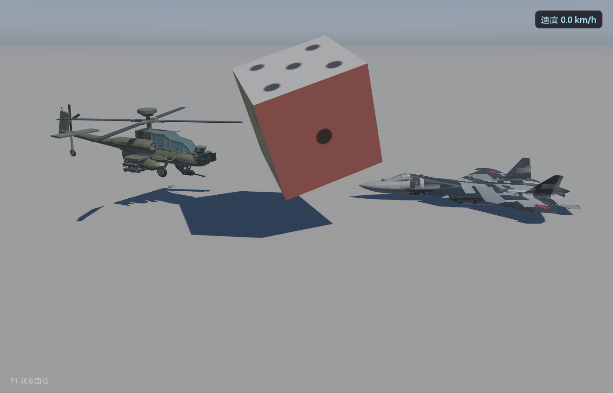
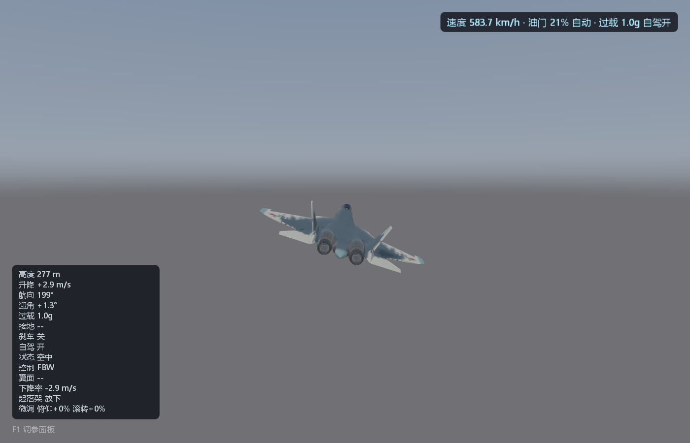
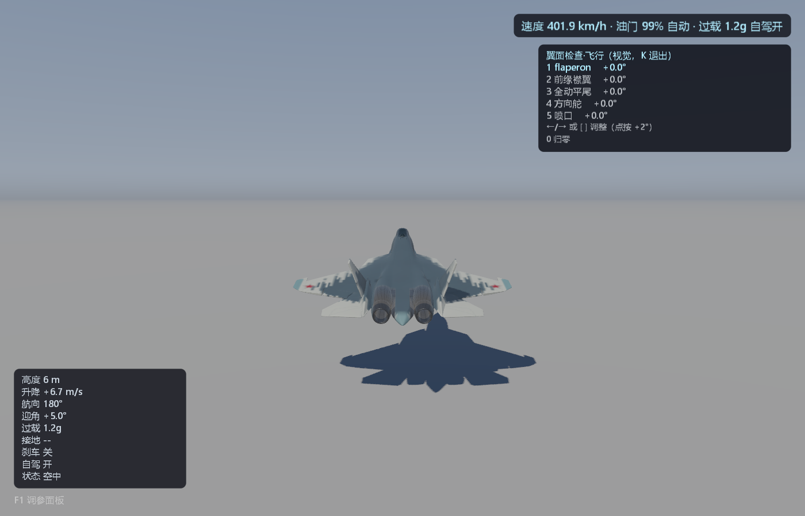

# RenderingCube / Su-57

当前版本：**v0.12.03**（[更新记录](CHANGELOG.md)）

OpenGL 3.3 Core C++ demo：硬边骰子，以及可拆件、可飞行的 Su-57。

## 2026-11-03 更新

- Su-57：把单块 `asset/su_57.glb` 运行时拆成机身 + 10 个控制面，带铰链点和限幅。
- 飞行：固定翼 6DOF、FBW 速率指令、PI 自动油门、过载限制（≤12g / ≥-3g）、倾斜转弯。
- 翼面：flaperon 滚转、全动平尾俯仰、方向舵偏航参与气动力矩；前缘襟翼按迎角调度，
  喷口目前只做视觉。
- 默认 FBW：`W/S/A/D/Q/E` 连续速率指令，飞行手感保持之前的版本。
- 直接翼面（可选）：`M` 进入，每次 0.5°、按住每 0.12 s 继续，松开保持；
  范围平尾 ±20°、flaperon 差动 ±25°、方向舵 ±20°。
- FBW 视觉翼面：只改显示，不改飞行物理；按键 0.5°/0.12 s，松开约 3°/s 缓慢回中。
- HUD：高度、升降速度、航向、迎角、过载、接地速度、刹车、自动油门、空中/地面；
  迎角接近失速时顶部闪烁 `STALL`。
- 降落/重置：接地事件记录垂直速度并自动收油门、刹车；`B` 刹车，
  小键盘 `4/6` 地面转向，`Backspace` 回停机位。
- 材质：UV + 顶部/腹部/侧面 BMP 数码迷彩，含 `054`、红星、白机鼻；
  贴图缺失时退回程序化迷彩。

## 2026-11-04 更新

- 增加起落架/前轮**逻辑状态**（不增加几何模型）：`L` 收起/放下，HUD 显示状态。
- 离地 3.2 m 内且起落架未收起、飞机不在爬升时，以 10 m/s² 平稳减速；收起起落架后不再触发。
- 高度 ≤50 m、起落架已收起且下降率大于 1 m/s 时，顶部闪烁 `PULL UP`；起落架放下时不显示。
- HUD 增加下降率显示（正值表示下降）。
- 移除姿态自动驾驶和自动降落（`H`）；只保留自动油门，降落需手动完成。
- 离地后自动收起落架；手动放下后不再自动收。
- 增加微调杆量：正常飞行时 `↑/↓` 低头/拉起，`←/→` 左/右滚；`X` 归零。
  K 翼面检查激活时方向键仍用于检查翼面。
- 左上角增加半透明浅绿色原位箭头：机头对准初始位置时指正上；目标在后方时指下，
  右侧/左侧分别指右/左；下方显示距原位距离。
- 离地 <3.2 m 且正在下降时，自动把俯仰改平、左右 flaperon 归零，模拟接地姿态；
  爬升起飞阶段不会触发。
- 地面滑跑时左右 flaperon 自动水平；数字键盘 `4/6` 左右转向；
  速度低于 70 m/s 时锁住抬头，同时锁住滚转并让移动方向的 Y 分量保持 0，达到抬轮速度后才允许离地。
- 地面时 `W/S/A/D/Q/E` 不生效，只保留微调、小键盘转向、油门/刹车/起落架；
  `K` 翼面检查仍可在静止或地面状态下检查包括 flaperon 在内的全部翼面。
- 移除直升机几何、飞行物理、驾驶交互、测试和专用文档；场景只保留地面、骰子和 Su-57。
- 验证：Debug 构建通过，`ctest` 2/2。

## 构建

```powershell
cmake --preset debug
cmake --build --preset debug
ctest --preset debug
.\build\Debug\RenderingCube.exe --fly-jet
```

依赖 VS2022 x64、CMake、GLFW/GLAD/GLM/cgltf；`asset/` 会自动复制到 exe 旁。

## 操作

| 键 | 作用 |
| --- | --- |
| J | 进入 / 退出喷气机飞行 |
| W / S / A / D / Q / E | FBW 俯仰 / 滚转 / 偏航；直接翼面模式下控制平尾 / flaperon / 方向舵 |
| M | 可选直接翼面：0.5°/0.12 s，松开保持 |
| X | 清除 FBW 视觉覆盖；直接翼面回中 |
| K | 翼面检查：1-5 选组，←/→ 或 [ ] 调整，0 归零 |
| B | 机轮刹车 |
| ↑ / ↓ / ← / → | 正常飞行时微调：低头 / 拉起 / 左滚 / 右滚；K 模式时用于翼面检查 |
| 小键盘 4 / 6 | 地面滑跑时左 / 右转向 |
| L | 收起 / 放下起落架（只有状态和 HUD，没有起落架几何模型） |
| Backspace | 重置到初始停机位 |
| T | 自动 / 手动油门 |
| Shift / Ctrl | 手动油门增减 |
| F1 | 调参面板 |

FBW 视觉：按键 0.5°，按住每 0.12 s 继续，松开约 3°/s 回中；飞行物理不变。
直接翼面：同样 0.5°/0.12 s，但松开保持，偏角直接产生力矩。
进入 `--fly-jet` 后没有自动起飞：自动油门会加速，需要拉杆离地；离地后起落架自动收起。
翼面检查范围：flaperon ±25°、前缘襟翼 0..20°、平尾 ±25°、方向舵 ±25°、喷口 ±14°。
HUD 现在还显示下降率、起落架状态和微调杆量；低空带起落架会有明显减速，注意提前收起。

## 已知限制

- 拆件是启发式切分，不是 DCC 手工拆件；大角度偏转会出现接缝/错位。
- livery 是平面 UV + 近似贴图，不是照片逐像素复刻；座舱盖/面板线未单独做。
- 地面是单点接触平地，没有跑道、起落架压缩/轮胎和损伤模型；重着陆只提示。
- 直接翼面是实验模式，默认仍使用 FBW。
- 前缘襟翼和喷口尚未接入升力/矢量推力力矩。

## 截图






