# RenderingCube

> **当前版本：v0.12.02**（2026-11-03）· 变更见 [CHANGELOG.md](CHANGELOG.md) · 完整手册见 [docs/MANUAL.md](docs/MANUAL.md)

基于 GLFW + GLAD + GLM 的 OpenGL 3.3 Core 渲染示例：硬边立方体落在超大地面片上，
Cook-Torrance PBR（GGX / Smith / Schlick Fresnel）、方向光阴影贴图（3x3 PCF）、
程序化天空球与粗糙度感知的环境反射近似，最后走 Reinhard 色调映射 + Gamma 校正。

v0.12 加入 AH-64D 风格直升机、可动旋翼与尾翼、简化飞行动力学、第三人称驾驶及实时速度面板。

场景默认还加载 `asset/su_57.glb`（约 150 万个三角形）：由 `cgltf` 解析成 `Mesh`，
用参数化 PBR 材质参与主 pass 与阴影 pass；按 `J` 可让它按固定翼气动起飞、爬升和盘旋，
`--no-model` 可回到只含骰子与直升机的场景。

## 依赖

全部随仓库提供，不做版本替换（构建时按 `third_party` 路径引用）：

| 依赖 | 位置 | 说明 |
| --- | --- | --- |
| GLFW 3.5.1 | `third_party/glfw` | x64 预编译静态库 `lib/glfw3.lib` |
| GLAD | `third_party/glad` | GL 3.3 core 加载器，源码编译为静态库 |
| GLM | `third_party/glm` | header-only 数学库 |
| cgltf 1.15 | `third_party/cgltf` | 单头文件 glTF/GLB 解析（MIT），无其它依赖 |

注意：随项目提供的 `glfw3.lib` 是 Debug CRT 构建的，因此 CMake 把所有目标统一成
`/MDd`，否则链接会报 LNK2038（RuntimeLibrary 不匹配）。

## 构建与运行

```powershell
# 技能自带的验证脚本（配置 + 干净构建 + ctest，可选截图回归）
./skills/rendering-cube-pbr/scripts/verify_project.ps1 -ProjectRoot .
./skills/rendering-cube-pbr/scripts/verify_project.ps1 -ProjectRoot . -Screenshot

# 等价的手工命令（CMakePresets 固定了生成器与输出目录）
cmake --preset debug
cmake --build --preset debug
ctest --preset debug
./build/Debug/RenderingCube.exe
```

Debug / RelWithDebInfo / Release 三种配置都能链接（都使用 Debug CRT，见上）。
构建结束后 `asset/` 会被复制到可执行文件旁边，输出目录可以整体拷走直接运行。

快照与帮助：

```text
RenderingCube --help      # 全部开关（未知参数会报错并以退出码 2 结束）
RenderingCube --version   # 版本号来自 CMake 的 project(VERSION)
```

## 操作

新增功能的调用入口、更新顺序和调参位置见 [载具代码调用索引](docs/VEHICLE_CODE_MAP.md)。

画面右上角显示当前载具速度，单位 km/h，保留一位小数。直升机驾驶时包含水平移动和
升降速度；喷气机飞行时显示喷气机速度，未启用飞行物理时显示 0.0。

| 输入 | 行为 |
| --- | --- |
| G | 靠近座舱后驾驶直升机；驾驶中可随时退出，按住不会反复切换 |
| J | 进入 / 退出喷气机飞行；进入后自动起飞 |
| P | 喷气机飞行时切换自动驾驶；有俯仰/滚转/偏航输入会自动退自驾并保持手动姿态 |
| 鼠标 | 自由模式转视角；驾驶模式仅控制第三人称观察，不改变飞机朝向 |
| W / S | 自由相机前后；驾驶时沿飞机自身朝向前进 / 后退 |
| A / D | 自由相机左右；驾驶时沿机身左 / 右侧移 |
| Page Up / Page Down | 自由相机升降；驾驶时爬升 / 下降 |
| 鼠标滚轮 | 自由模式平滑升降；驾驶模式拉近 / 拉远跟随距离 |
| 空格 / 左 Ctrl | 驾驶时爬升 / 下降；自由模式空格暂停 / 继续骰子自转 |
| R | 未激活物理时暂停 / 继续旋翼；进入过驾驶后开关发动机，旋翼平滑加减速 |
| Q / E | 驾驶时转向并调整尾桨变距；静态展示时仅调整尾桨变距 |
| Z / C | 水平尾翼偏转；驾驶时附带轻微俯仰配平 |
| T | 喷气机飞行时切换自动 / 手动油门 |
| B | 喷气机接地后切换机轮刹车；刹车时禁用地面转向 |
| Backspace | 把喷气机重置到初始停机位（自驾/自动油门关、刹车开） |
| K | 静止时进入 / 退出翼面检查；1-5 选择翼面组，←/→ 或 [ ] 调整，0 归零 |
| Left Shift | 移动加速；喷气机飞行时为手动油门增加 |
| Esc | 退出 |

喷气机飞行中：`W / S` 推杆低头 / 拉杆抬头，`A / D` 左 / 右滚转，`Q / E` 偏航；
`P` 切换自动驾驶，`T` 切换自动油门，`Shift / Ctrl` 在手动油门下增减推力；
鼠标与滚轮调整第三人称跟随视角。速度药丸同时显示油门、过载和自驾状态。

翼面检查（静止、非飞行时按 `K`）：`1` flaperon、`2` 前缘襟翼、`3` 全动平尾、
`4` 方向舵、`5` 喷口；`→` 增加、`←` 减小（`]`/`[` 同义），点按先加/减 2°，
按住以 25°/s 连续变化，松开后角度保持；`0` 归零。各组范围：flaperon ±25°、
前缘襟翼 0..20°、平尾 ±25°、方向舵 ±25°、喷口 ±14°。该模式只驱动视觉偏角，
不参与气动力矩。

降落与重置：先按 `P` 断开自驾、`T` 断开自动油门，用 `Ctrl` 收油门并对准地面下降；
接地后自动收油门、断开自驾并刹车，HUD 记录接地垂直速度，`B` 可松开刹车滑跑。
`Backspace` 随时把飞机放回初始停机位；重置后按 `B` 松刹车、`P` 自驾、`T` 自动油门即可重新起飞。
HUD 左下角显示高度、升降速度、航向、迎角、过载、接地速度、刹车、自驾和空中/地面状态；
迎角接近失速时顶部闪烁 `STALL`。

## 对外配置接口

常见调整不需要改 `PBRRenderer` 或 GLSL：

```cpp
Application application;
application.setDirectionalLight(light);   // 方向 + 辐照度
application.setLightDirection(glm::vec3(-0.55f, -1.0f, -0.42f));
application.setCubeMaterial(cubeMaterial); // 六面统一材质
application.setCubeFaceMaterial(0, material); // 只改一个面（0=+Z,1=-Z,2=+X,3=-X,4=+Y,5=-Y）
application.setPipsEnabled(false);         // 关掉骰子点数，只留每面颜色
application.setGroundMaterial(groundMaterial);
application.setReflectionStrength(0.55f);  // [0, 1]
application.setObjectOpacity(0.62f);       // [0, 1]，小于 1 走半透明路径
application.enableShadows(true);
application.setMouseLookEnabled(false);    // 释放鼠标、忽略视角增量
```

材质是金属度-粗糙度工作流：`albedo, metallic, roughness, ao, opacity`，
`roughness` 会被夹紧到 `[0.04, 1]`。

**骰子（每面一套材质）**：立方体不是"一个材质画满"，而是把 6×6 个索引按面切成
六段，每段用各自材质 draw 一次（`Mesh::drawRange`）。面顺序与法线一致：

```cpp
// 读-改-写：保留每面颜色，只统一 roughness
for (int face = 0; face < Application::kCubeFaceCount; ++face) {
    PBRMaterial faceMaterial = application.cubeFaceMaterial(face);
    faceMaterial.roughness = 0.2f;
    application.setCubeFaceMaterial(face, faceMaterial);
}
```

点数（1..6）是**在片元着色器里画出来的**，不是几何体，也不需要贴图：着色器用对象空间
坐标把每个面归一化到 `[-1,1]`，再按 3×3 网格点亮对应位置。所以点数不会增加顶点数，
也不产生自己的阴影/凹陷；如果要真正的凹点，需要几何或法线贴图。

材质默认是代码里的数据，`glframework/lighting/` 已经够用；Su-57 的 livery 是例外：
它需要 `asset/texture/su57_top/bottom/side.bmp` 和 `glframework/texture/Texture2D`。

## 命令行开关

```text
--transparent            不透明度 0.62
--opacity <0..1>         指定不透明度
--roughness <value>      覆盖六面的粗糙度（保留每面颜色）
--metallic <0..1>        覆盖六面的金属度（保留每面颜色）
--no-pips                不画骰子点数，只显示每面材质颜色
--aircraft-only          仅显示飞机和地面，便于近距离检查机头
--model <file.glb>       加载外部 glTF/GLB（默认 su_57.glb，相对 asset/）
--no-model               不加载外部模型
--fly-jet                启动后直接进入喷气机飞行（否则按 J）
--surface-test           启动后进入翼面检查（K 切换，1-5 选择，←/→ 或 [ ] 调整）
--drive                  启动时尝试驾驶，仍需用 --camera 把相机放在座舱附近
--no-rotors              启动时暂停旋翼，运行中可用 R 继续
--main-rotor-angle <度>  主旋翼初始相位
--tail-rotor-angle <度>  尾桨初始相位
--tail-pitch <度>        尾桨初始变距（夹紧到 ±18°）
--stabilator-angle <度>  水平尾翼初始偏角（夹紧到 ±20°）
--run-for <秒>          运行指定时长后退出；配合截图则在运行结束后截图
--no-spin                启动时不自转（运行中仍可用空格开启）
--spin-angle <度>        固定自转角度，用于截图逐像素复现
--no-shadow              关闭阴影 pass
--no-reflection          关闭环境反射
--no-mouse               释放鼠标并忽略视角输入
--hidden                 隐藏窗口（仍可渲染）
--screenshot <file.bmp>  离屏渲染一帧（4x MSAA，与窗口一致）并写 24 位 BMP 后退出
--ui                     启动时就打开调参面板（F1 切换）
--help / -h              显示全部开关
--version                显示版本
```

`--screenshot` 不需要可见窗口，渲染结果逐像素可复现（含 4x MSAA），适合做回归对比：

```powershell
./build/Debug/RenderingCube.exe --screenshot shot.bmp
```

## 目录结构

```text
application/            Application.h/.cpp      窗口、输入、渲染顺序、配置接口
glframework/
  Shader.h/.cpp         源码加载、#include 预处理、编译链接、uniform 缓存、错误日志
  ShaderWatcher.h/.cpp  热重载：按 mtime 监视全部着色器及其 #include 依赖
  AssetPath.h/.cpp      资产目录解析（exe 同级 asset/ 优先，源码树路径兜底）
  GlUtil.h              move-only GL 句柄 + Debug 下的 glGetError 断言
  Camera.h/.cpp         视角与移动（帧时间缩放）
  ShadowMap.h/.cpp      深度纹理 + 深度-only 帧缓冲（不管光照几何）
  SkyDome.h/.cpp        程序化天空球（内视、去平移、深度压到远平面）
  SunSprite.h/.cpp      可选太阳图层（billboard、程序化或 BMP 贴图材质）
  ui/Overlay.h/.cpp     即时模式覆盖层：文字、圆角面板、滑杆/开关（取代旧的 GDI 速度面板）
  geometry/Mesh.h/.cpp  VAO + position/color/normal 三个 VBO + EBO
  geometry/MeshBuilder.h/.cpp  程序化几何累加（盒体/圆柱/放样，自动纠正绕序）
  geometry/GltfLoader.h/.cpp   glTF/GLB → CPU 三角网格（cgltf，缺法线时补平滑法线）
  geometry/Su57Rig.h/.cpp      单块 su_57 网格按估算铰链切成机身 + 10 个控制面
  texture/Texture2D.h/.cpp     BMP livery 贴图加载与 GL 绑定
  physics/
    HelicopterDynamics.h/.cpp   直升机 120 Hz 刚体 + 旋翼/辅助飞控
    FixedWingDynamics.h/.cpp    固定翼 6DOF：升力/阻力/失速/推力/地面
    FixedWingAutopilot.h/.cpp   起飞、爬升、高度/速度保持与盘旋
    FixedWingParameters.h       固定翼演示参数（公开估算，非实机标定）
  scene/                场景层：对象只产出 DrawItem，不认识渲染器
    DrawItem.h          一次绘制：几何 / 变换 / 材质 / 点数 / 索引段
    SceneObject.h       对象接口（appendDrawItems / appendShadowItems）
    MeshObject.h/.cpp   通用"网格 + 材质"（地面）
    DiceObject.h/.cpp   骰子（六面材质 + 点数 + 自转）
    HelicopterObject.h/.cpp  程序化直升机（放样机身 + 尾翼 + 旋翼 + 滑橇）
    GltfObject.h/.cpp   glTF 模型（每个 primitive 一条 DrawItem）
    FixedWingObject.h/.cpp  glTF 视觉 + 固定翼物理，每帧写 Model
    Scene.h/.cpp        对象容器
  lighting/
    DirectionalLight.h  方向 + 辐照度（没有物理位置）
    PBRMaterial.h       材质参数与夹紧
    LightRig.h/.cpp     方向光 + 光源正交矩阵 + 太阳方向
    PBRRenderer.h/.cpp  PBR Shader 与全部 uniform 命名
asset/shader/           pbr / shadowDepth / skyDome / sun / ui 着色器
  common/sky.glsl       程序化天空的唯一实现，被 pbr.frag 与 skyDome.frag 共同 #include
asset/texture/          sun_soft.bmp（太阳示例材质）
src/main.cpp            命令行解析（未知参数报错）+ 少量默认配置
```

## 渲染顺序

```text
1. 深度 pass（光源视角）
   绑定阴影帧缓冲 -> 地面写深度 -> 立方体只画背面写深度 -> 恢复场景帧缓冲与视口
2. 主 pass
   清颜色/深度 -> 天空球（深度写关闭）-> 地面（不透明 PBR）-> 立方体六面各一次 draw
   （opacity < 1 时最后、alpha 混合）-> 太阳
3. 覆盖层
   三维绘制结束后一次性提交：速度药丸 + （F1）调参面板；用显式状态块保存/恢复 GL 状态
```

## 实现要点

- 立方体是**单位立方体**（顶点落在 ±1），位置、旋转、尺寸全部由 Model 矩阵给出；
  这样片元着色器里的对象空间坐标就是归一化的面坐标，骰子点数不需要额外 uniform。
- 立方体用 24 个顶点：每个面四个独立顶点 + 一个恒定面法线，硬边不带平滑；
  6 个面 × 6 个索引连续排列，`Mesh::drawRange(face * 6, 6)` 精确切出一个面。
- 每面一套 `PBRMaterial`（默认红/绿/蓝/琥珀/米白/紫，粗糙度从 0.12 到 0.55，
  其中一面是金属），观察"同一光照下不同材质"的差异。
- 骰子点数在 `pbr.frag` 里用对象空间坐标画：按对象空间法线选面内两轴，3×3 网格 + 位掩码
  点亮 1..6 个圆点，边缘用 `fwidth` 做一像素级抗锯齿；点数只改 albedo，不参与几何。
- 自转是"角度状态 + 时间积分"：`m_spinAngle` 只在启用时按 `m_spinSpeed * dt` 累加，
  暂停就是停止累加（角度原地保留），恢复从同一角度继续；每帧用这个角度重建模型矩阵，
  阴影 pass 与主 pass 共用同一份变换，所以本体和阴影永远同步。
- 方向光只有方向和辐照度；阴影用的"光源相机"沿光线反方向后退 18 单位构造正交投影，
  它不代表灯光有位置。
- 阴影：深度 pass 只写投射者（立方体）的深度，并且只画背面；地面是纯接收者，
  不写进 shadow map —— 否则地面会和自己比较，必须加 polygon offset 把阴影整体推开，
  而那一步正是"立方体脚下亮缝"的主因。地面不参与后，既无地面自阴影，也不需要 offset，
  阴影就能贴住接触点。立方体底面高度由 `kCubeCenterHeight` 决定（默认 0.805 → 离地 5mm），
  避免与地面共面 z-fighting。
- 光源正交框 ±9、深度范围压到 15–21（而不是 0.5–40）：同样大小的 NDC 偏移换算成世界
  单位小一个数量级，阴影不会"缩离"投影体。
- 采样用斜率相关偏移 + 白色边界（超出光源视锥按受光处理）+ 3x3 PCF。
- 半透明立方体在深度 pass 里仍然写深度（否则地面阴影会消失），它的可见阴影在 PBR 里
  按投射者 `opacity` 削弱。
- 天空球去掉 View 的平移分量、用 `xyww` 把深度压到远平面，因此只随相机旋转。
- 环境反射直接复用同一 `proceduralSky()`，配合粗糙度感知 Fresnel。这是近似，
  不是预滤波 IBL；没有 HDR 环境贴图和镜面预过滤。
- 地面距离雾让 1200 单位的地面片自然过渡到地平线颜色，避免出现可见的接缝。
- uniform 位置在首次 `set*` 时查询一次并缓存（`Shader::uniformLocation`），之后只走名字查找；
  Debug 下名字拼错会打印一次 `uniform ... not found`，不再静默失效。
- 着色器支持 `#include "相对路径"`：`common/sky.glsl` 是程序化天空的唯一实现，
  `pbr.frag`（环境反射/雾）与 `skyDome.frag`（背景）包含同一份，反射与天空不可能再漂移。
- 离屏截图先渲染到多重采样 renderbuffer，再 blit 到单采样纹理读取，因此 `--screenshot`
  与窗口的 4x MSAA 观感一致（此前截图是硬边缘的）。
- 临时 GL 资源（截图 FBO、覆盖层缓冲）走 `GlUtil.h` 的 move-only 句柄，析构即删除；
  `GlStateBlock` 一次性保存/恢复覆盖层用到的状态，不再靠逐项手工 restore。
- 改 `.vert/.frag` 后无需重启：`ShaderWatcher` 每 0.4 秒 stat 一次依赖文件，
  链接成功才替换程序，写错时保留旧程序并只打印驱动日志。
- 覆盖层是自带的即时模式层（无第三方 UI 库）：文字由系统字体一次性栅格化成图集，
  每帧只做纹理采样；圆角面板用 SDF 抗锯齿，不依赖 MSAA。

## 已知近似

- 骰子点数是"画上去"的：没有凹陷、没有法线扰动，也不投自己的阴影。
- Alpha 混合表示透射，没有折射、没有按面排序（半透明对象只画正面）。
- 半透明立方体的地面阴影按投射者不透明度缩放（0.62 时约 38% 的直射光被遮挡），不透明度为 0 时阴影一同消失。
- 没有级联阴影，正交投影只覆盖场景中心约 18x18 单位（±9）；范围外按全受光处理。
- 光源是单方向光，没有点光/聚光和环境探针。
- 覆盖层的文字栅格化使用 Windows 系统字体（GDI 只在启动时把字形画进图集）；
  其它平台会退化为不显示文字，三维渲染与截图不受影响。
- 调参面板改动的是运行期状态，不写回代码或命令行；重启即恢复默认。
- glTF 模型只读取静态网格和 metallic-roughness 参数：贴图、skin、morph、动画和
  Draco/meshopt 压缩几何都不参与渲染；`su_57.glb` 的 NORMAL 由加载器补算，硬边会被平滑。
- 1.5M 三角形模型默认参与阴影 pass；`--no-shadow` 可把几何负载减半。
- 固定翼物理是演示模型：参数来自公开估算，辅助飞控不是 Su-57 电传控制律；
  过载限制是升力硬限幅（≤12g / ≥-3g），姿态保持基于速率指令而不是实机电传。
- 控制面拆件是启发式切分：边界来自包围盒/平面估算，大角度偏转会有接缝/错位；
  前缘襟翼和喷口目前只做视觉，不产生升力/矢量推力。

## 验证清单

`verify_project.ps1` 只覆盖构建；运行期还需要确认：

- 立方体表面没有条纹/斑点状自阴影 acne。
- 三个可见面的颜色不同、点数正确（1 / 4 / 5），旋转后点数仍贴在各自面上。
- 地面没有出现过曝的白色圆盘（地面 roughness 0.90）。
- 阴影随光方向移动，边缘没有明显锯齿。
- 转动相机时天空只旋转不平移。
- `--transparent` 时背景能从立方体透出，地面阴影仍可见。
- `--help` 列出全部开关；拼错的参数（例如 `--no-shdow`）以退出码 2 失败，不再静默忽略。
- `--ui` 打开面板后拖动滑杆，画面立即响应；F1 关闭后光标回到鼠标观察模式。
- 默认场景右侧出现 su_57；`--no-model` 后场景与旧版本一致；`GltfLoader` ctest 通过。
- `--fly-jet --run-for 6 --screenshot` 能看到起飞；`ctest` 的 `FixedWingFlight` 用例通过。
- 运行中修改 `asset/shader/pbr/pbr.frag`，控制台出现 `[Shader] reloaded:` 且画面更新；
  把着色器改坏时打印编译错误但画面保持上一版。

## 截图

以下截图由 `--screenshot` 离屏渲染生成（参数固定，逐像素可复现）：

| 默认骰子（六面各自材质 + 点数） | 半透明（`--transparent`） | 金属（`--metallic 1.0 --roughness 0.18`） |
| --- | --- | --- |
| 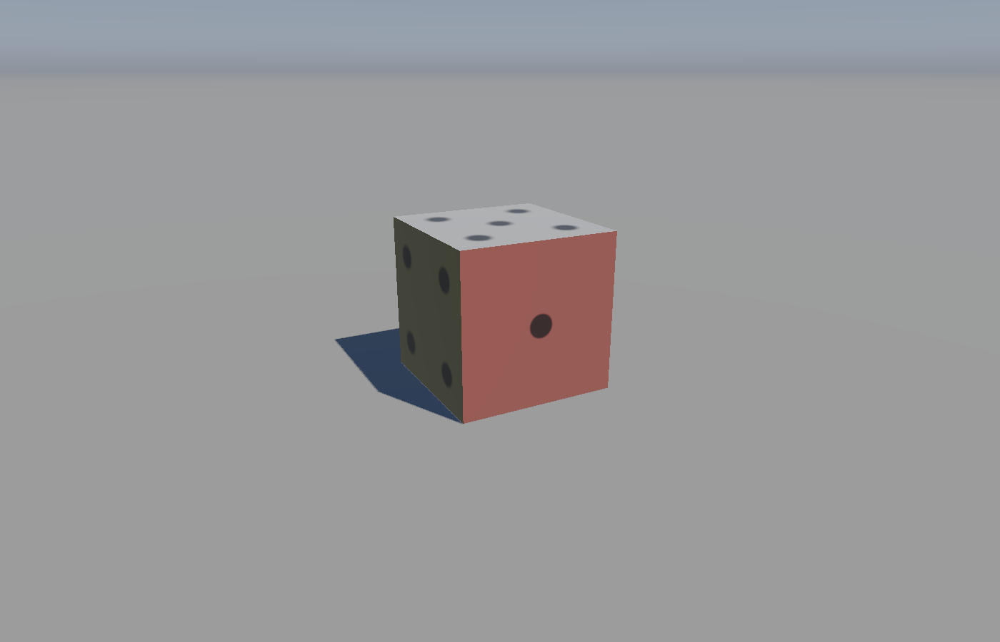 | 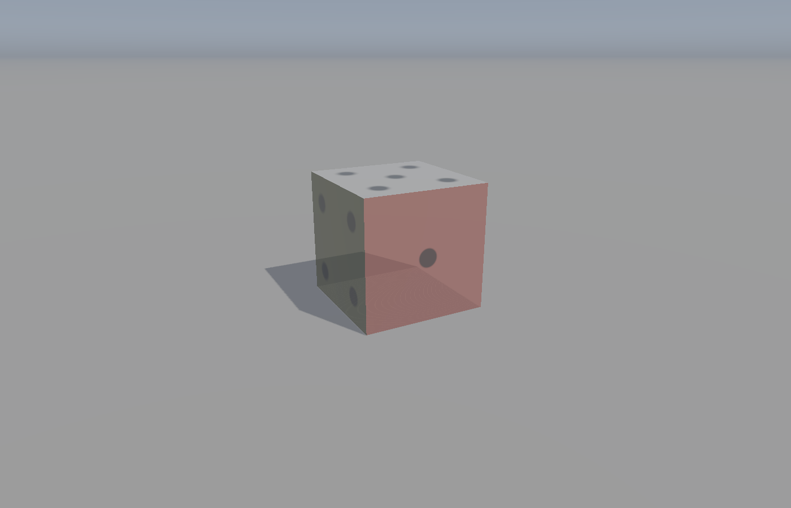 | 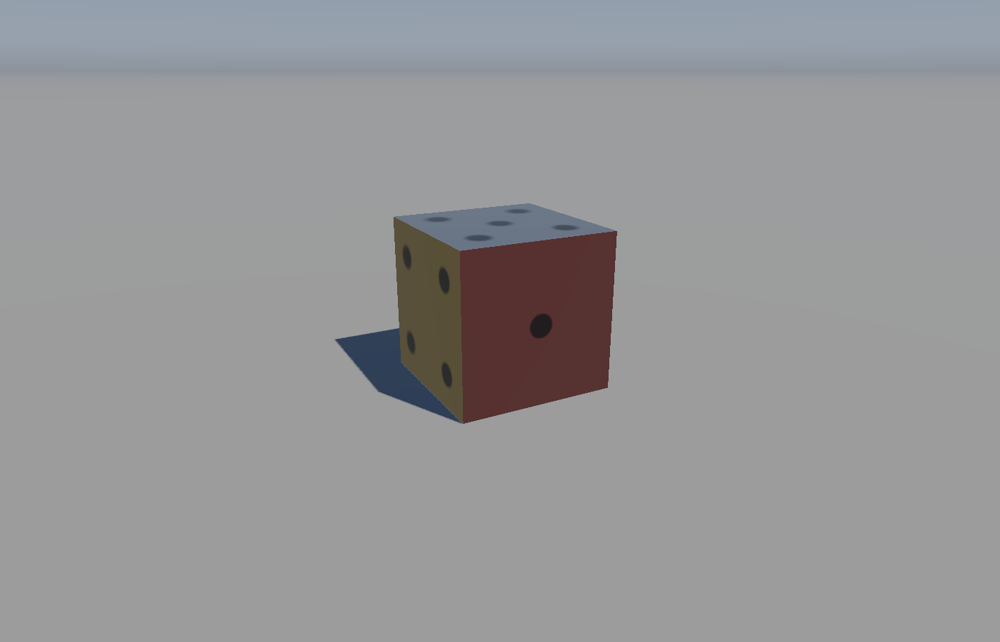 |

关闭阴影（`--no-shadow`）用于对比直射光的贡献：

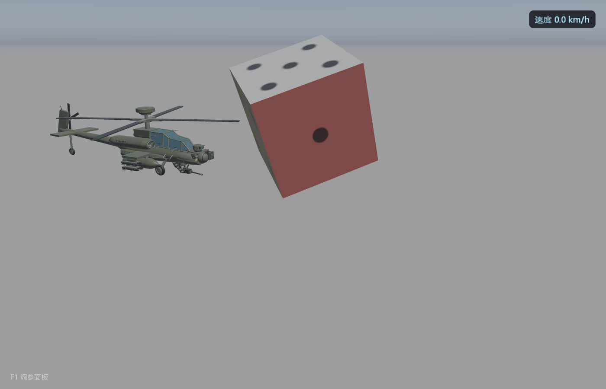

F1 调参面板（`--ui` 启动即打开，覆盖层替代了旧的速度面板）：

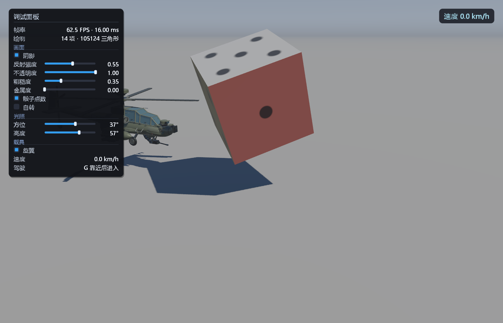

默认加载的 `asset/su_57.glb`（静态网格 + 参数化 PBR 材质，阴影默认开启）：


喷气机巡航（`--fly-jet --run-for 40`）：HUD 显示 583.7 km/h、高度 277 m、迎角 1.3°、1.0g：


翼面检查（`--surface-test` 或按 `K`）：1-5 选择，`[` / `]` 调整，面板实时显示各组角度：

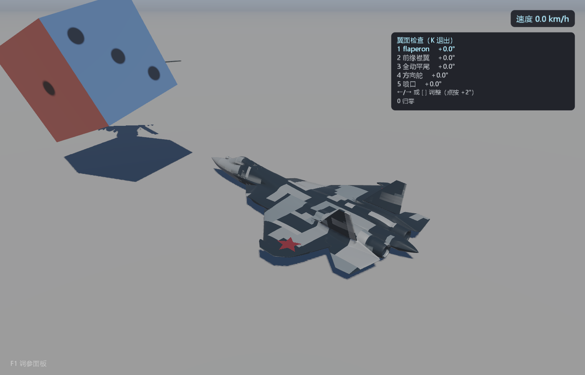

## 图片参考武装直升机（AttackHelicopterGeometry）

`glframework/geometry/AttackHelicopterGeometry.h/.cpp` 提供独立的程序化模型，
默认放在骰子左侧，原有红色直升机已从场景和构建目标中移除。包含军绿色机体、串列座舱与窗框、
双发动机、Longbow 雷达、55°/125° 剪刀式尾桨、四挂点短翼、十九管 M261 火箭巢、
八枚 Hellfire、230 加仑外置副油箱、轮式起落架和 TADS/PNVS 机头传感器等外形。
这是图片风格的高细分外形近似，支持主/尾旋翼转动、尾桨变距和水平尾翼偏转；
支持简化刚体飞行动力学与第三人称驾驶；不含写实贴图或透明玻璃。

```cpp
#include "AttackHelicopterGeometry.h"
#include "AttackHelicopterObject.h"

// 在 OpenGL 上下文建立后调用；网格随 Scene 在上下文销毁前释放。
const PBRMaterial material{glm::vec3(1.0f), 0.25f, 0.50f, 1.0f, 1.0f};
auto& helicopter = scene.add<AttackHelicopterObject>(
    AttackHelicopterGeometry::createMeshes(), material, model);
helicopter.update(deltaSeconds); // 每帧一次，在绘制和阴影 pass 之前
```

局部坐标为 +X 机头、+Y 向上、+Z 右侧；一单位对应约两米，合并几何接口输出 315,330 个顶点、105,110 个三角形。
`appendTo(MeshBuilder&)` 可在无 OpenGL 上下文时生成 CPU 几何，
`createMesh()` 则生成并上传网格。颜色使用顶点色，因此材质 albedo 建议设为白色。
动画默认使用 `createMeshes()`，输出机身、主旋翼、尾桨单叶、水平尾翼四份网格；
四片尾桨共用同一份叶片网格，每帧通过七个 DrawItem 分别摆放，只更新变换，不重复上传顶点。
动画状态与部件变换在 `glframework/scene/AttackHelicopterObject.h/.cpp`，
按键和时间调度在 `application/Application.cpp`。
详见 [动画实现与文件职责](docs/AH64D_ANIMATION.md)。
飞行动力学放在 `glframework/physics/`，第三人称相机放在 `glframework/ThirdPersonCamera.*`。
按 `G` 后启用 120 Hz 固定步长的重力、旋翼升力、阻力、姿态力矩和起落架地面接触；
松键自动减速并保持悬停，退出驾驶后飞机继续由辅助控制稳定，相机恢复自由移动。
飞机和摄像头通过惯性及平滑跟随连接，详细控制与模型限制见 [飞行与驾驶说明](docs/AH64D_FLIGHT.md)。

`createMesh(Loadout::Combat)` 使用双火箭巢与八枚导弹，
`createMesh(Loadout::Ferry)` 使用双副油箱与八枚导弹；默认 `Loadout::Mixed`
为左内火箭巢、右内副油箱、两侧外挂点各四枚导弹。每个挂点只装一种挂载。
尺寸依据、挂点表和拟合精度限制见 [AH-64D 参考说明](docs/AH64D_REFERENCE.md)。

曲面平滑通过增加顶点与连续法线实现，仍使用位置/颜色/法线三个 VBO。
机身、发动机和油箱采用最多 64 段环向细分、原截面间 12 段纵向细分与保形三次插值；
圆柱侧面使用径向法线，端盖、窗框、翼面保持硬边。
轮胎和进气口边缘使用环面，并补充风扇、轮毂螺栓、舱盖紧固件、铰链与门把手。
飞机的阴影 pass 使用闭合体背面深度，消除机身表面的自阴影条纹。

几何验证覆盖三种挂载的顶点、索引、法线、退化三角形，以及圆柱/放样端盖方向、
曲面解析法线、环面和非均匀缩放后的法线保持：
`ctest --test-dir build-verify -C Debug --output-on-failure`。

当前验证程序位于 `build-verify/Debug/RenderingCube.exe`（原 `build` 缓存记录了旧路径）。

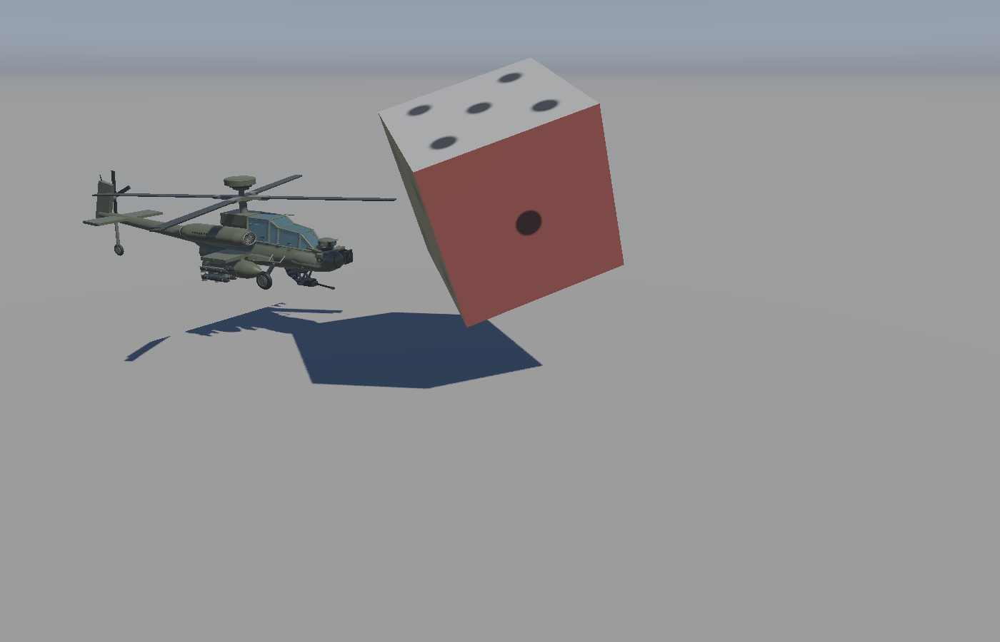

机头按近景参考重做了宽下颌和两侧整流罩、非对称 TADS 圆形/方形模块、独立上置 PNVS、
转轴与支架、传感器窗口与密封圈，并细化机炮吊架、供弹链、前风挡和雨刷。
可用以下命令重现近景：

```powershell
./build-verify/Debug/RenderingCube.exe --aircraft-only --no-mouse --camera -1.05 1.55 0.1 -123 -18
```

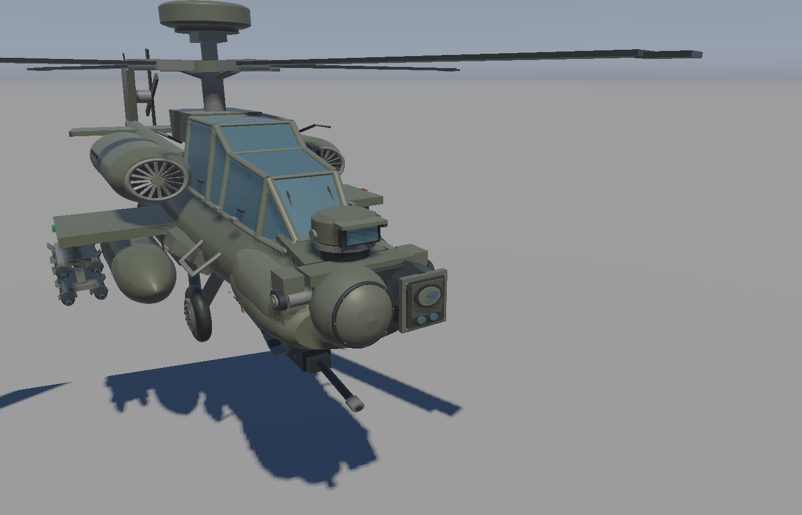

## 外部 glTF 模型（su_57）

`asset/su_57.glb` 是默认加载的静态模型（约 749,628 顶点 / 1,499,268 三角形），
文件本身没有 NORMAL、材质、贴图、skin 和动画，加载器会补平滑法线并使用一套参数化
`PBRMaterial`。链路与项目其它对象一致：

```text
GltfLoader（CPU 解析，cgltf）
  -> Application::createGltfModel 上传 Mesh
  -> GltfObject::appendDrawItems 产出 DrawItem
  -> PBRRenderer / 阴影 pass 消费 DrawItem
```

- 模型入口：`--model <file.glb>`，相对路径按资产目录解析；`--no-model` 关闭。
- 放置：按包围盒把底部对齐 `y=0`，中心放在 `(3.2, 0, -1.5)`，缩放 3.6。
- 阴影：默认参与；1.5M 三角形对阴影 pass 有成本，帧率不足时用 `--no-shadow`。
- 当前只支持静态网格、节点变换和 metallic-roughness 参数：贴图、skin、morph、
  animation、Draco/meshopt 压缩会被忽略或明确拒绝。
- CPU 解析不需要 GL 上下文，`ctest --preset debug` 中的 `GltfLoader` 用例校验
  顶点/索引数量、索引范围、法线长度和包围盒。

### Su-57 054 参考涂装与分区材质

按用户提供的上下视参考重绘蓝灰/浅灰数码迷彩，取代随机大方块。顶部和腹部贴图为
3072×2048，侧面为 2048×1024，包含白边红星、蓝绿色翼尖、细面板线与侧面 054 机号。
贴图由 `tools/make_su57_livery.py` 统一生成（需要 Pillow、NumPy），从任意目录运行；
`tools/make_su57_side.py` 保留为侧面贴图的兼容入口。生成结果已随资产保存，运行时无需 Python。

`asset/shader/common/su57.glsl` 仅由 Su-57 的 materialMode=2 启用，分开处理漆面、
雷达罩、深色反光座舱、尾锥和带环纹/喷口瓣缝的热变色金属；贴图缺失时保留程序化迷彩。
平面投影负责上下表面，侧面投影限于机身和垂尾，避免冲淡翼面红星；纹理启用 mipmap
以减少远距离像素边界闪烁。没有改变现有控制面变换和飞行动力学。

当前仍是源网格坐标投影与程序化分区，不是逐像素照片复刻：左右迷彩近似对称，
参考图中的不对称像素、细密铆钉、机号位置、玻璃内部和烧蚀旧化尚有差异；
座舱为不透明反光近似，没有新增内部模型或折射。

新增 `--jet-only` 隐藏其它物体和地面，可检查腹部，默认场景不变。当前路径可独立构建：

```powershell
cmake -S . -B build-material -A x64
cmake --build build-material --config Debug --target RenderingCube
./build-material/Debug/RenderingCube.exe --jet-only --no-mouse --camera 1.4 2.7 2.6 -64 -29
```

验证：Debug 编译；四项 CTest 通过；NVIDIA OpenGL 3.3 实际加载 GLSL，输出顶部、
腹部和斜前方的 4x MSAA 截图。

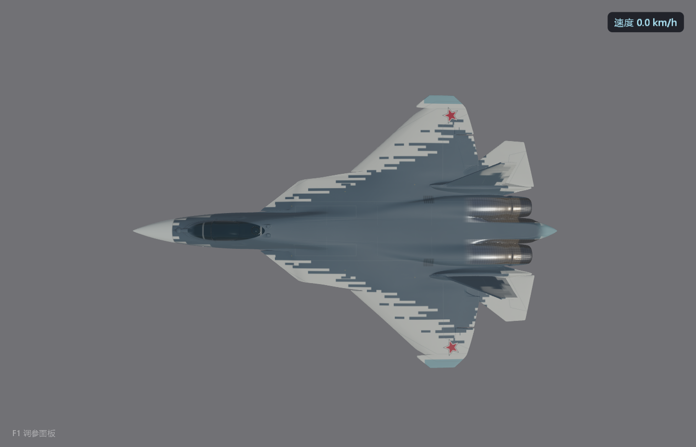
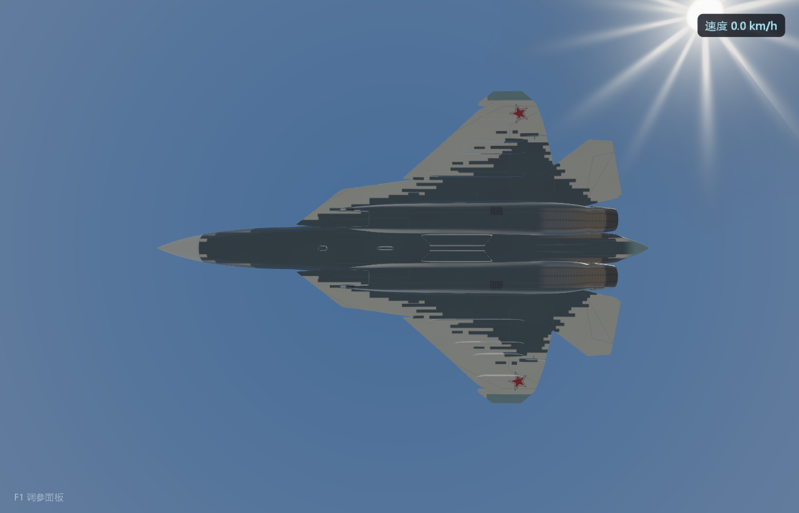
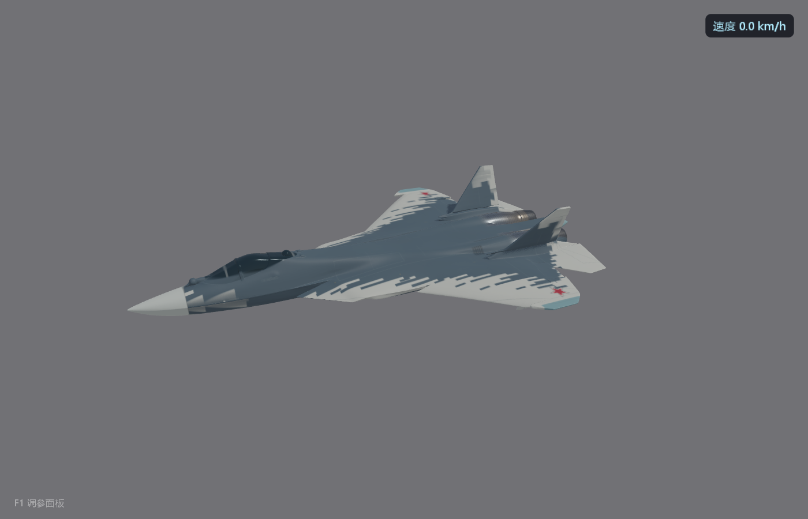

### 喷气机飞行（FixedWingDynamics）

`J` 或 `--fly-jet` 启用固定翼物理，视觉模型由 `FixedWingObject` 每帧按物理状态写 Model：

- 120 Hz 固定步长 6DOF：升力/阻力/侧力由空速、迎角和动压计算，失速后 CL 下降、CD 上升；
  推力沿机体 +X，重力在世界坐标；法向过载、角速度和姿态都由力/力矩积分。
- 参数在 `glframework/physics/FixedWingParameters.h`：质量 18 t、翼面积 78.8 m²、
  最大推力 2×147 kN 等，属于公开资料估算，不是 Su-57 实机标定。
- 辅助飞控先完成起飞（约 72 m/s 抬轮）、爬升到 300 m，再以约 160 m/s 盘旋。
  姿态手动输入会自动退出自驾并保持当前姿态；按 `P` 可重新接入自驾（改平机翼并保持高度）。
- 姿态保持：松开操纵后目标角速度为 0，俯仰/滚转姿态保持，不再像原型一样 2 秒后被自驾拉回。
- 过载限制：升力硬限幅为 **≤12g / ≥-3g**；继续拉杆只会增大迎角，不会突破结构过载。
  速度药丸显示当前过载。
- 倾斜转弯：侧滑产生垂尾风标偏航，机头跟随速度矢量；压坡度后升力的水平分量改变航向，
  第三人称相机也跟着机体航向转动（鼠标输入作为相对偏移保留）。
- 油门是独立通道：默认自动油门用 PI 速度保持，稳态约 160 m/s；按 `T` 或
  `Shift / Ctrl` 切到手动油门，手动值会一直保持，直到再按 `T` 回到自动。
  速度药丸显示“油门 xx% 自动/手动”。
- 驾驶手感限幅：俯仰 0.35 rad/s、滚转 1.1 rad/s、偏航 0.3 rad/s，避免原型的快速翻滚失真。
- 第三人称相机使用与视觉相同的物理插值状态作为焦点，避免 120 Hz 步进在高速/急转时
  造成画面抖动；跟随系数也按喷气机速度单独调过。
- 控制面：`Su57Rig` 把整块网格按估算铰链切成机身 + 10 个面（左右 flaperon、前缘襟翼、
  全动平尾、方向舵、喷口）。飞控把目标角加速度反解成翼面偏角，再由翼面力矩推动角速度积分；
  视觉旋转和力矩使用同一份偏角。flaperon/平尾/方向舵参与力矩，前缘襟翼/喷口目前只做视觉。
- 翼面检查：`K` 或 `--surface-test` 进入；1-5 选择，`←`/`→`（或 `[`/`]`）点按 2°、
  按住 25°/s，松开保持，`0` 归零；范围 flaperon ±25°、前缘襟翼 0..20°、平尾 ±25°、
  方向舵 ±25°、喷口 ±14°。该模式只改视觉偏角，不参与气动力矩；飞行中要先 `J` 退出。
- HUD：左下角显示高度、升降速度、航向、迎角、过载、接地速度、刹车、自驾和空中/地面状态；
  速度药丸保留速度/油门/过载/自驾；迎角超过失速角 90% 时顶部闪烁 `STALL`。
- 降落：断开自驾和自动油门后下降；接地产生 touchdown 事件并记录垂直速度，自动收油门、
  断开自驾并刹车；`B` 松开刹车，低速时 `Q/E` 可地面转向，`Backspace` 重置到停机位。
- `FixedWingFlight` ctest 覆盖起飞/巡航、过载范围（-3g .. 12g）、俯仰姿态保持、倾斜转弯、
  接地事件和刹车减速。

当前限制：拆件是**启发式切分**，不是 DCC 里按真实铰链手工拆的。边界来自包围盒/平面估算，
大角度偏转时会出现接缝和轻微错位；前缘襟翼和喷口暂不产生升力/矢量推力。
地面是单点接触的平地，没有跑道、起落架压缩/轮胎模型和损伤模型；刹车用滚动阻力近似，
重着陆只提示，不损坏飞机。
要获得可用品质，最好提供拆好节点的 GLB，替换 `Su57Rig` 的估算区域即可。

## 太阳图层（SunSprite）

独立、可整体移除的太阳：`glframework/SunSprite.*` + `asset/shader/sun.vert|frag`，
位置由光方向决定（`sunDir = -light.direction`），所以太阳与阴影天然一致。

- 不修改天空 / PBR / 现有着色器；删掉 `Application` 里的 `m_sun.render(...)` 就等于删掉太阳。
- 换材质两种方式：`setSunStyle(SunStyle{...})` 调参数，或 `setSunTexture("asset/texture/sun_soft.bmp")`
  换成贴图（约定"亮度当 alpha"，白色不透明、黑色透明）。
- 命令行：`--sun <radiance>`、`--sun-texture <file.bmp>`、`--camera x y z yaw pitch`。

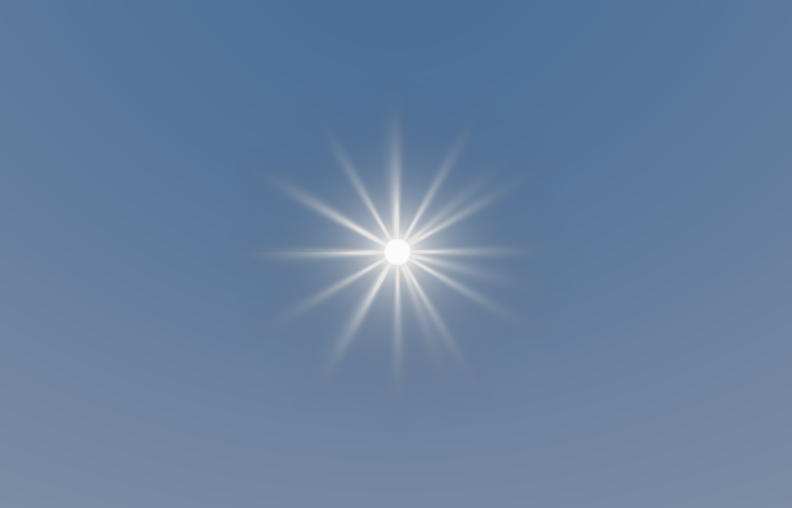

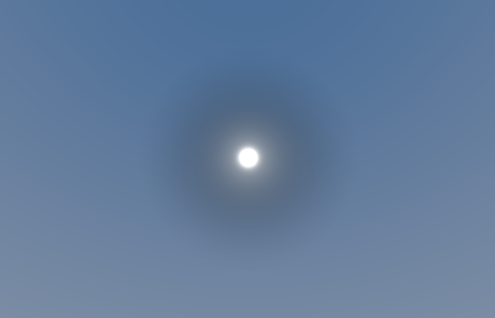

已知取舍：太阳没有进入 `proceduralSky()`，因此骰子的环境反射里看不到它（低耦合的代价）。
