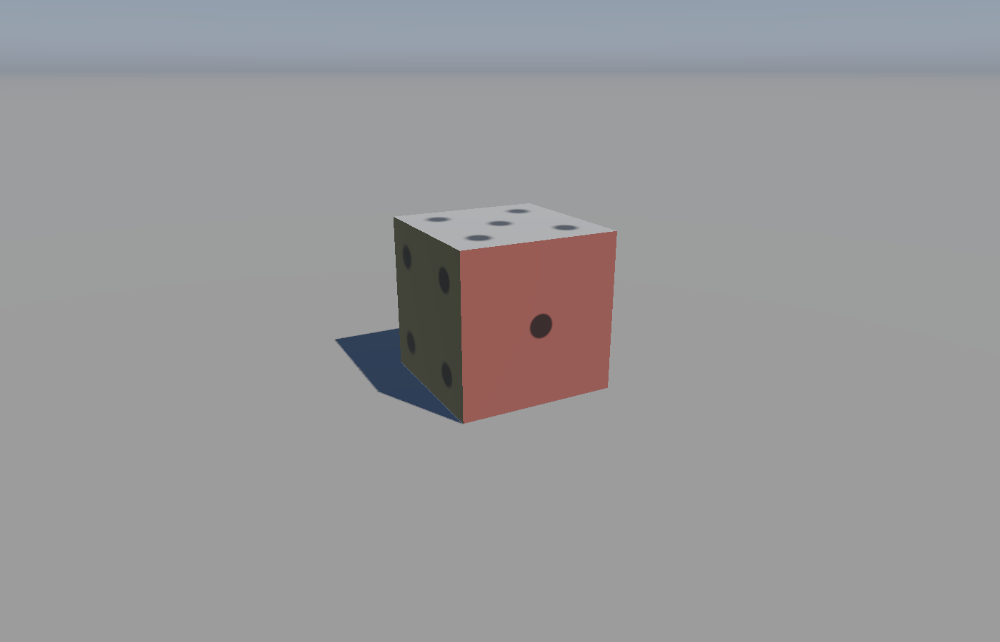
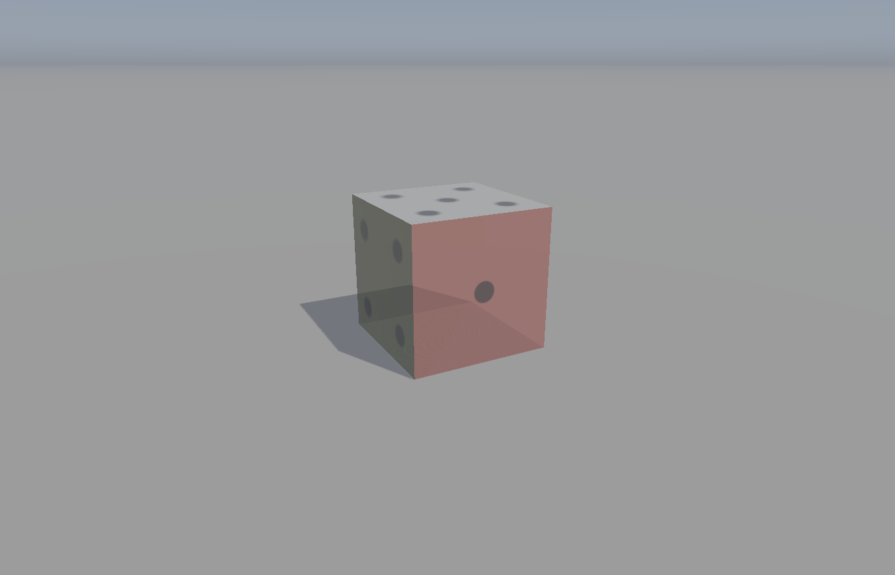
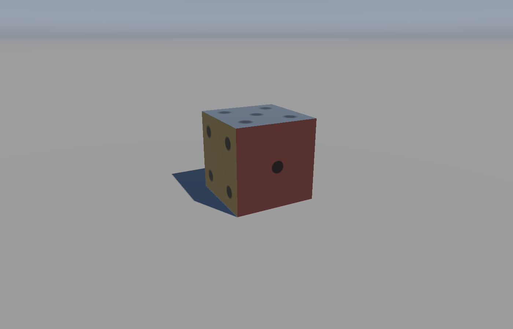
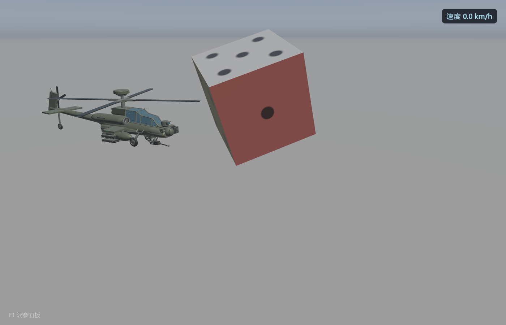
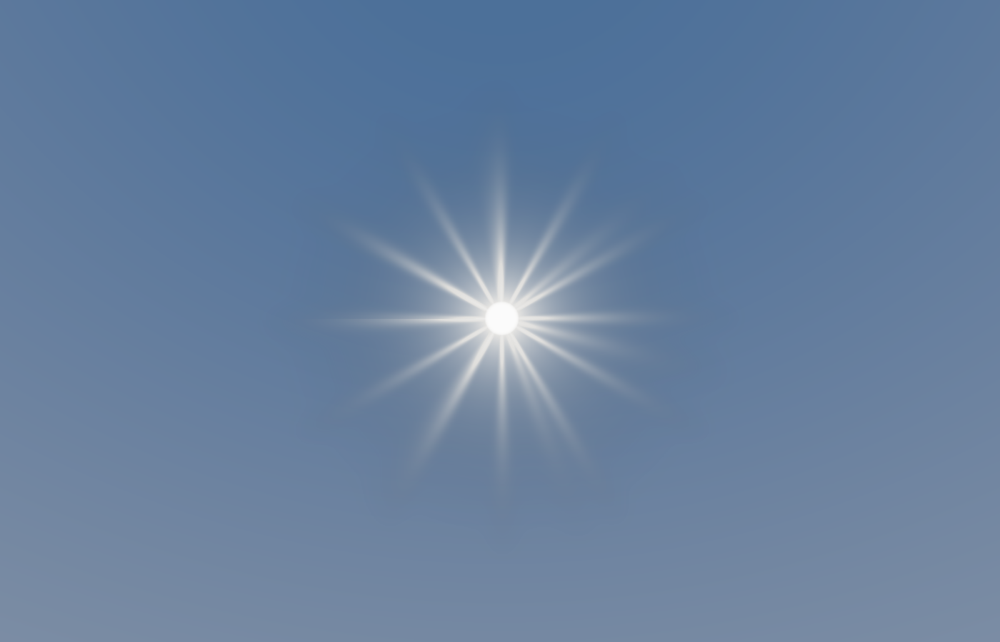
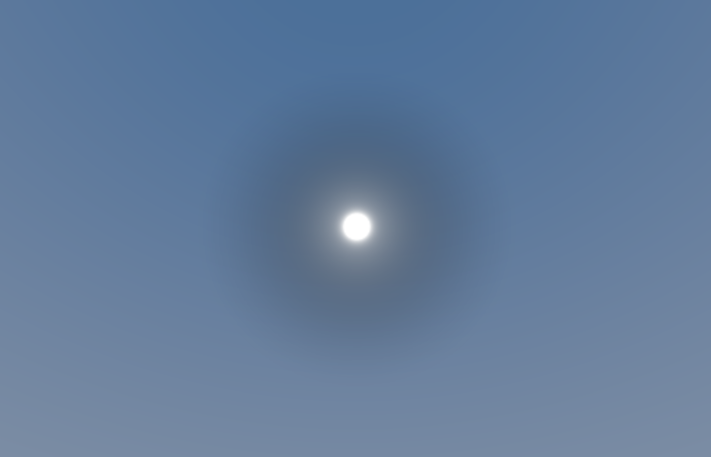

# RenderingCube

> **当前版本：v0.11**（2026-10-31）· 变更见 [CHANGELOG.md](CHANGELOG.md) · 完整手册见 [docs/MANUAL.md](docs/MANUAL.md)

基于 GLFW + GLAD + GLM 的 OpenGL 3.3 Core 渲染示例：硬边立方体落在超大地面片上，
Cook-Torrance PBR（GGX / Smith / Schlick Fresnel）、方向光阴影贴图（3x3 PCF）、
程序化天空球与粗糙度感知的环境反射近似，最后走 Reinhard 色调映射 + Gamma 校正。

## 依赖

全部随仓库提供，不做版本替换（构建时按 `third_party` 路径引用）：

| 依赖 | 位置 | 说明 |
| --- | --- | --- |
| GLFW 3.5.1 | `third_party/glfw` | x64 预编译静态库 `lib/glfw3.lib` |
| GLAD | `third_party/glad` | GL 3.3 core 加载器，源码编译为静态库 |
| GLM | `third_party/glm` | header-only 数学库 |

注意：随项目提供的 `glfw3.lib` 是 Debug CRT 构建的，因此 CMake 把所有目标统一成
`/MDd`，否则链接会报 LNK2038（RuntimeLibrary 不匹配）。

## 构建与运行

```powershell
# 技能自带的验证脚本（配置 + 干净构建）
./skills/rendering-cube-pbr/scripts/verify_project.ps1 -ProjectRoot .

# 等价的手工命令
& 'C:/Program Files/CMake/bin/cmake.exe' -S . -B build -G 'Visual Studio 17 2022' -A x64
& 'C:/Program Files/CMake/bin/cmake.exe' --build build --config Debug
./build/Debug/RenderingCube.exe
```

Debug / RelWithDebInfo / Release 三种配置都能链接（都使用 Debug CRT，见上）。

## 操作

| 输入 | 行为 |
| --- | --- |
| 鼠标 | 视角（yaw / pitch，pitch 限制 ±89°） |
| W / S | 前后（沿水平前向，抬头不会起飞） |
| A / D | 左右 |
| Page Up / Page Down | 世界 Y 升降 |
| 鼠标滚轮 | 世界 Y 升降（每格 0.25，指数平滑过渡，不再是瞬移） |
| 空格 | 暂停 / 继续立方体自转（边沿触发，按住不会连续翻转） |
| Left Shift | 移动加速 |
| Esc | 退出 |

## 对外配置接口

常见调整不需要改 `PBRRenderer` 或 GLSL：

```cpp
Application application;
application.setDirectionalLight(light);   // 方向 + 辐照度
application.setLightDirection(glm::vec3(-0.55f, -1.0f, -0.42f));
application.setCubeMaterial(cubeMaterial); // 六面统一材质
application.setCubeFaceMaterial(0, material); // 只改一个面（0=+Z,1=-Z,2=+X,3=-X,4=+Y,5=-Y）
application.setPipsEnabled(false);         // 关掉骰子点数，只留每面颜色
application.setGroundMaterial(groundMaterial);
application.setReflectionStrength(0.55f);  // [0, 1]
application.setObjectOpacity(0.62f);       // [0, 1]，小于 1 走半透明路径
application.enableShadows(true);
application.setMouseLookEnabled(false);    // 释放鼠标、忽略视角增量
```

材质是金属度-粗糙度工作流：`albedo, metallic, roughness, ao, opacity`，
`roughness` 会被夹紧到 `[0.04, 1]`。

**骰子（每面一套材质）**：立方体不是"一个材质画满"，而是把 6×6 个索引按面切成
六段，每段用各自材质 draw 一次（`Mesh::drawRange`）。面顺序与法线一致：

```cpp
// 读-改-写：保留每面颜色，只统一 roughness
for (int face = 0; face < Application::kCubeFaceCount; ++face) {
    PBRMaterial faceMaterial = application.cubeFaceMaterial(face);
    faceMaterial.roughness = 0.2f;
    application.setCubeFaceMaterial(face, faceMaterial);
}
```

点数（1..6）是**在片元着色器里画出来的**，不是几何体，也不需要贴图：着色器用对象空间
坐标把每个面归一化到 `[-1,1]`，再按 3×3 网格点亮对应位置。所以点数不会增加顶点数，
也不产生自己的阴影/凹陷；如果要真正的凹点，需要几何或法线贴图。

不需要为材质新建目录：材质是代码里的数据，`glframework/lighting/` 已经够用；
只有当点数改用贴图时，才值得加 `asset/texture/`。

## 命令行开关

```text
--transparent            不透明度 0.62
--opacity <0..1>         指定不透明度
--roughness <value>      覆盖六面的粗糙度（保留每面颜色）
--metallic <0..1>        覆盖六面的金属度（保留每面颜色）
--no-pips                不画骰子点数，只显示每面材质颜色
--no-spin                启动时不自转（运行中仍可用空格开启）
--spin-angle <度>        固定自转角度，用于截图逐像素复现
--no-shadow              关闭阴影 pass
--no-reflection          关闭环境反射
--no-mouse               释放鼠标并忽略视角输入
--hidden                 隐藏窗口（仍可渲染）
--screenshot <file.bmp>  离屏渲染一帧并写 24 位 BMP 后退出
```

`--screenshot` 不需要可见窗口，渲染结果逐像素可复现，适合做回归对比：

```powershell
./build/Debug/RenderingCube.exe --screenshot shot.bmp
```

## 目录结构

```text
application/            Application.h/.cpp      窗口、输入、渲染顺序、配置接口
glframework/
  Shader.h/.cpp         源码加载、编译链接、uniform 设置、错误日志
  Camera.h/.cpp         视角与移动（帧时间缩放）
  ShadowMap.h/.cpp      深度纹理 + 深度-only 帧缓冲 + 光源正交矩阵
  SkyDome.h/.cpp        程序化天空球（内视、去平移、深度压到远平面）
  SunSprite.h/.cpp      可选太阳图层（billboard、程序化或 BMP 贴图材质）
  geometry/Mesh.h/.cpp  VAO + position/color/normal 三个 VBO + EBO
  lighting/
    DirectionalLight.h  方向 + 辐照度（没有物理位置）
    PBRMaterial.h       材质参数与夹紧
    PBRRenderer.h/.cpp  PBR Shader 与全部 uniform 命名
asset/shader/           pbr / shadowDepth / skyDome / sun 四组着色器
asset/texture/          sun_soft.bmp（太阳示例材质）
src/main.cpp            命令行解析 + 少量默认配置
```

## 渲染顺序

```text
1. 深度 pass（光源视角）
   绑定阴影帧缓冲 -> 地面写深度 -> 立方体只画背面写深度 -> 恢复场景帧缓冲与视口
2. 主 pass
   清颜色/深度 -> 天空球（深度写关闭）-> 地面（不透明 PBR）-> 立方体六面各一次 draw
   （opacity < 1 时最后、alpha 混合）
```

## 实现要点

- 立方体是**单位立方体**（顶点落在 ±1），位置、旋转、尺寸全部由 Model 矩阵给出；
  这样片元着色器里的对象空间坐标就是归一化的面坐标，骰子点数不需要额外 uniform。
- 立方体用 24 个顶点：每个面四个独立顶点 + 一个恒定面法线，硬边不带平滑；
  6 个面 × 6 个索引连续排列，`Mesh::drawRange(face * 6, 6)` 精确切出一个面。
- 每面一套 `PBRMaterial`（默认红/绿/蓝/琥珀/米白/紫，粗糙度从 0.12 到 0.55，
  其中一面是金属），观察"同一光照下不同材质"的差异。
- 骰子点数在 `pbr.frag` 里用对象空间坐标画：按对象空间法线选面内两轴，3×3 网格 + 位掩码
  点亮 1..6 个圆点，边缘用 `fwidth` 做一像素级抗锯齿；点数只改 albedo，不参与几何。
- 自转是"角度状态 + 时间积分"：`m_spinAngle` 只在启用时按 `m_spinSpeed * dt` 累加，
  暂停就是停止累加（角度原地保留），恢复从同一角度继续；每帧用这个角度重建模型矩阵，
  阴影 pass 与主 pass 共用同一份变换，所以本体和阴影永远同步。
- 方向光只有方向和辐照度；阴影用的"光源相机"沿光线反方向后退 18 单位构造正交投影，
  它不代表灯光有位置。
- 阴影：深度 pass 只写投射者（立方体）的深度，并且只画背面；地面是纯接收者，
  不写进 shadow map —— 否则地面会和自己比较，必须加 polygon offset 把阴影整体推开，
  而那一步正是"立方体脚下亮缝"的主因。地面不参与后，既无地面自阴影，也不需要 offset，
  阴影就能贴住接触点。立方体底面高度由 `kCubeCenterHeight` 决定（默认 0.805 → 离地 5mm），
  避免与地面共面 z-fighting。
- 光源正交框 ±9、深度范围压到 15–21（而不是 0.5–40）：同样大小的 NDC 偏移换算成世界
  单位小一个数量级，阴影不会"缩离"投影体。
- 采样用斜率相关偏移 + 白色边界（超出光源视锥按受光处理）+ 3x3 PCF。
- 半透明立方体在深度 pass 里仍然写深度（否则地面阴影会消失），它的可见阴影在 PBR 里
  按投射者 `opacity` 削弱。
- 天空球去掉 View 的平移分量、用 `xyww` 把深度压到远平面，因此只随相机旋转。
- 环境反射直接复用同一 `proceduralSky()`，配合粗糙度感知 Fresnel。这是近似，
  不是预滤波 IBL；没有 HDR 环境贴图和镜面预过滤。
- 地面距离雾让 1200 单位的地面片自然过渡到地平线颜色，避免出现可见的接缝。

## 已知近似

- 骰子点数是"画上去"的：没有凹陷、没有法线扰动，也不投自己的阴影。
- Alpha 混合表示透射，没有折射、没有按面排序（半透明对象只画正面）。
- 半透明立方体的地面阴影按投射者不透明度缩放（0.62 时约 38% 的直射光被遮挡），不透明度为 0 时阴影一同消失。
- 没有级联阴影，正交投影只覆盖场景中心约 18x18 单位（±9）；范围外按全受光处理。
- 光源是单方向光，没有点光/聚光和环境探针。

## 验证清单

`verify_project.ps1` 只覆盖构建；运行期还需要确认：

- 立方体表面没有条纹/斑点状自阴影 acne。
- 三个可见面的颜色不同、点数正确（1 / 4 / 5），旋转后点数仍贴在各自面上。
- 地面没有出现过曝的白色圆盘（地面 roughness 0.90）。
- 阴影随光方向移动，边缘没有明显锯齿。
- 转动相机时天空只旋转不平移。
- `--transparent` 时背景能从立方体透出，地面阴影仍可见。

## 截图

以下截图由 `--screenshot` 离屏渲染生成（参数固定，逐像素可复现）：

| 默认骰子（六面各自材质 + 点数） | 半透明（`--transparent`） | 金属（`--metallic 1.0 --roughness 0.18`） |
| --- | --- | --- |
|  |  |  |

关闭阴影（`--no-shadow`）用于对比直射光的贡献：



## 太阳图层（SunSprite）

独立、可整体移除的太阳：`glframework/SunSprite.*` + `asset/shader/sun.vert|frag`，
位置由光方向决定（`sunDir = -light.direction`），所以太阳与阴影天然一致。

- 不修改天空 / PBR / 现有着色器；删掉 `Application` 里的 `m_sun.render(...)` 就等于删掉太阳。
- 换材质两种方式：`setSunStyle(SunStyle{...})` 调参数，或 `setSunTexture("asset/texture/sun_soft.bmp")`
  换成贴图（约定"亮度当 alpha"，白色不透明、黑色透明）。
- 命令行：`--sun <radiance>`、`--sun-texture <file.bmp>`、`--camera x y z yaw pitch`。





已知取舍：太阳没有进入 `proceduralSky()`，因此骰子的环境反射里看不到它（低耦合的代价）。