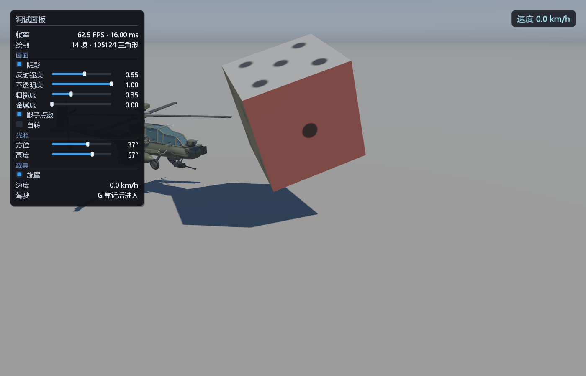
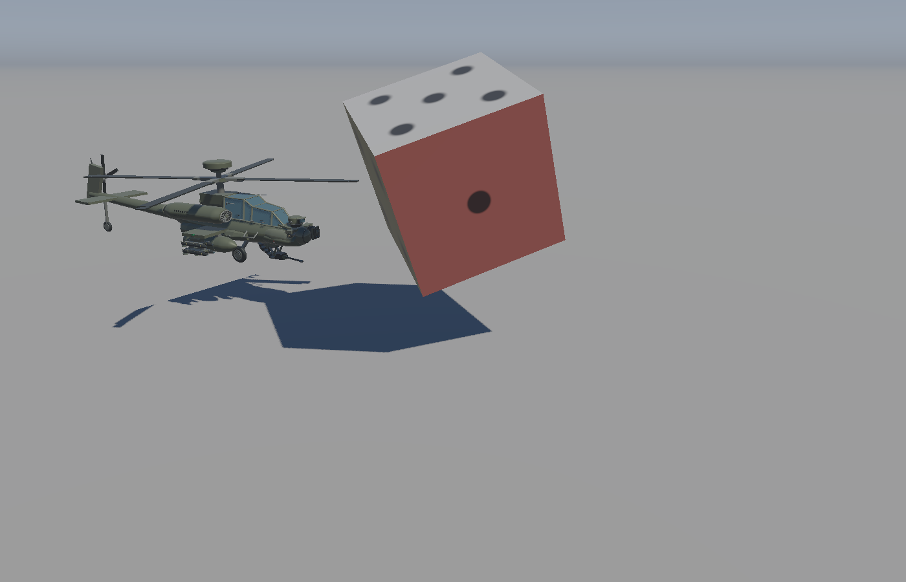

# RenderingCube

> **当前版本：v0.12.01**（2026-11-02）· 变更见 [CHANGELOG.md](CHANGELOG.md) · 完整手册见 [docs/MANUAL.md](docs/MANUAL.md)

基于 GLFW + GLAD + GLM 的 OpenGL 3.3 Core 渲染示例：硬边立方体落在超大地面片上，
Cook-Torrance PBR（GGX / Smith / Schlick Fresnel）、方向光阴影贴图（3x3 PCF）、
程序化天空球与粗糙度感知的环境反射近似，最后走 Reinhard 色调映射 + Gamma 校正。

v0.12 加入 AH-64D 风格直升机、可动旋翼与尾翼、简化飞行动力学、第三人称驾驶及实时速度面板。

## 依赖

全部随仓库提供，不做版本替换（构建时按 `third_party` 路径引用）：

| 依赖 | 位置 | 说明 |
| --- | --- | --- |
| GLFW 3.5.1 | `third_party/glfw` | x64 预编译静态库 `lib/glfw3.lib` |
| GLAD | `third_party/glad` | GL 3.3 core 加载器，源码编译为静态库 |
| GLM | `third_party/glm` | header-only 数学库 |

注意：随项目提供的 `glfw3.lib` 是 Debug CRT 构建的，因此 CMake 把所有目标统一成
`/MDd`，否则链接会报 LNK2038（RuntimeLibrary 不匹配）。

## 构建与运行

```powershell
# 技能自带的验证脚本（配置 + 干净构建 + ctest，可选截图回归）
./skills/rendering-cube-pbr/scripts/verify_project.ps1 -ProjectRoot .
./skills/rendering-cube-pbr/scripts/verify_project.ps1 -ProjectRoot . -Screenshot

# 等价的手工命令（CMakePresets 固定了生成器与输出目录）
cmake --preset debug
cmake --build --preset debug
ctest --preset debug
./build/Debug/RenderingCube.exe
```

Debug / RelWithDebInfo / Release 三种配置都能链接（都使用 Debug CRT，见上）。
构建结束后 `asset/` 会被复制到可执行文件旁边，输出目录可以整体拷走直接运行。

快照与帮助：

```text
RenderingCube --help      # 全部开关（未知参数会报错并以退出码 2 结束）
RenderingCube --version   # 版本号来自 CMake 的 project(VERSION)
```

## 操作

新增功能的调用入口、更新顺序和调参位置见 [载具代码调用索引](docs/VEHICLE_CODE_MAP.md)。

画面右上角显示直升机当前速度，单位 km/h，保留一位小数，包含水平移动和升降速度。
未启用飞行物理时显示 0.0；驾驶和自由观察模式均可查看。

| 输入 | 行为 |
| --- | --- |
| G | 靠近座舱后驾驶直升机；驾驶中可随时退出，按住不会反复切换 |
| 鼠标 | 自由模式转视角；驾驶模式仅控制第三人称观察，不改变飞机朝向 |
| W / S | 自由相机前后；驾驶时沿飞机自身朝向前进 / 后退 |
| A / D | 自由相机左右；驾驶时沿机身左 / 右侧移 |
| Page Up / Page Down | 自由相机升降；驾驶时爬升 / 下降 |
| 鼠标滚轮 | 自由模式平滑升降；驾驶模式拉近 / 拉远跟随距离 |
| 空格 / 左 Ctrl | 驾驶时爬升 / 下降；自由模式空格暂停 / 继续骰子自转 |
| R | 未激活物理时暂停 / 继续旋翼；进入过驾驶后开关发动机，旋翼平滑加减速 |
| Q / E | 驾驶时转向并调整尾桨变距；静态展示时仅调整尾桨变距 |
| Z / C | 水平尾翼偏转；驾驶时附带轻微俯仰配平 |
| Left Shift | 移动加速 |
| Esc | 退出 |

## 对外配置接口

常见调整不需要改 `PBRRenderer` 或 GLSL：

```cpp
Application application;
application.setDirectionalLight(light);   // 方向 + 辐照度
application.setLightDirection(glm::vec3(-0.55f, -1.0f, -0.42f));
application.setCubeMaterial(cubeMaterial); // 六面统一材质
application.setCubeFaceMaterial(0, material); // 只改一个面（0=+Z,1=-Z,2=+X,3=-X,4=+Y,5=-Y）
application.setPipsEnabled(false);         // 关掉骰子点数，只留每面颜色
application.setGroundMaterial(groundMaterial);
application.setReflectionStrength(0.55f);  // [0, 1]
application.setObjectOpacity(0.62f);       // [0, 1]，小于 1 走半透明路径
application.enableShadows(true);
application.setMouseLookEnabled(false);    // 释放鼠标、忽略视角增量
```

材质是金属度-粗糙度工作流：`albedo, metallic, roughness, ao, opacity`，
`roughness` 会被夹紧到 `[0.04, 1]`。

**骰子（每面一套材质）**：立方体不是"一个材质画满"，而是把 6×6 个索引按面切成
六段，每段用各自材质 draw 一次（`Mesh::drawRange`）。面顺序与法线一致：

```cpp
// 读-改-写：保留每面颜色，只统一 roughness
for (int face = 0; face < Application::kCubeFaceCount; ++face) {
    PBRMaterial faceMaterial = application.cubeFaceMaterial(face);
    faceMaterial.roughness = 0.2f;
    application.setCubeFaceMaterial(face, faceMaterial);
}
```

点数（1..6）是**在片元着色器里画出来的**，不是几何体，也不需要贴图：着色器用对象空间
坐标把每个面归一化到 `[-1,1]`，再按 3×3 网格点亮对应位置。所以点数不会增加顶点数，
也不产生自己的阴影/凹陷；如果要真正的凹点，需要几何或法线贴图。

不需要为材质新建目录：材质是代码里的数据，`glframework/lighting/` 已经够用；
只有当点数改用贴图时，才值得加 `asset/texture/`。

## 命令行开关

```text
--transparent            不透明度 0.62
--opacity <0..1>         指定不透明度
--roughness <value>      覆盖六面的粗糙度（保留每面颜色）
--metallic <0..1>        覆盖六面的金属度（保留每面颜色）
--no-pips                不画骰子点数，只显示每面材质颜色
--aircraft-only          仅显示飞机和地面，便于近距离检查机头
--drive                  启动时尝试驾驶，仍需用 --camera 把相机放在座舱附近
--no-rotors              启动时暂停旋翼，运行中可用 R 继续
--main-rotor-angle <度>  主旋翼初始相位
--tail-rotor-angle <度>  尾桨初始相位
--tail-pitch <度>        尾桨初始变距（夹紧到 ±18°）
--stabilator-angle <度>  水平尾翼初始偏角（夹紧到 ±20°）
--run-for <秒>          运行指定时长后退出；配合截图则在运行结束后截图
--no-spin                启动时不自转（运行中仍可用空格开启）
--spin-angle <度>        固定自转角度，用于截图逐像素复现
--no-shadow              关闭阴影 pass
--no-reflection          关闭环境反射
--no-mouse               释放鼠标并忽略视角输入
--hidden                 隐藏窗口（仍可渲染）
--screenshot <file.bmp>  离屏渲染一帧（4x MSAA，与窗口一致）并写 24 位 BMP 后退出
--ui                     启动时就打开调参面板（F1 切换）
--help / -h              显示全部开关
--version                显示版本
```

`--screenshot` 不需要可见窗口，渲染结果逐像素可复现（含 4x MSAA），适合做回归对比：

```powershell
./build/Debug/RenderingCube.exe --screenshot shot.bmp
```

## 目录结构

```text
application/            Application.h/.cpp      窗口、输入、渲染顺序、配置接口
glframework/
  Shader.h/.cpp         源码加载、#include 预处理、编译链接、uniform 缓存、错误日志
  ShaderWatcher.h/.cpp  热重载：按 mtime 监视全部着色器及其 #include 依赖
  AssetPath.h/.cpp      资产目录解析（exe 同级 asset/ 优先，源码树路径兜底）
  GlUtil.h              move-only GL 句柄 + Debug 下的 glGetError 断言
  Camera.h/.cpp         视角与移动（帧时间缩放）
  ShadowMap.h/.cpp      深度纹理 + 深度-only 帧缓冲（不管光照几何）
  SkyDome.h/.cpp        程序化天空球（内视、去平移、深度压到远平面）
  SunSprite.h/.cpp      可选太阳图层（billboard、程序化或 BMP 贴图材质）
  ui/Overlay.h/.cpp     即时模式覆盖层：文字、圆角面板、滑杆/开关（取代旧的 GDI 速度面板）
  geometry/Mesh.h/.cpp  VAO + position/color/normal 三个 VBO + EBO
  geometry/MeshBuilder.h/.cpp  程序化几何累加（盒体/圆柱/放样，自动纠正绕序）
  scene/                场景层：对象只产出 DrawItem，不认识渲染器
    DrawItem.h          一次绘制：几何 / 变换 / 材质 / 点数 / 索引段
    SceneObject.h       对象接口（appendDrawItems / appendShadowItems）
    MeshObject.h/.cpp   通用"网格 + 材质"（地面）
    DiceObject.h/.cpp   骰子（六面材质 + 点数 + 自转）
    HelicopterObject.h/.cpp  程序化直升机（放样机身 + 尾翼 + 旋翼 + 滑橇）
    Scene.h/.cpp        对象容器
  lighting/
    DirectionalLight.h  方向 + 辐照度（没有物理位置）
    PBRMaterial.h       材质参数与夹紧
    LightRig.h/.cpp     方向光 + 光源正交矩阵 + 太阳方向
    PBRRenderer.h/.cpp  PBR Shader 与全部 uniform 命名
asset/shader/           pbr / shadowDepth / skyDome / sun / ui 着色器
  common/sky.glsl       程序化天空的唯一实现，被 pbr.frag 与 skyDome.frag 共同 #include
asset/texture/          sun_soft.bmp（太阳示例材质）
src/main.cpp            命令行解析（未知参数报错）+ 少量默认配置
```

## 渲染顺序

```text
1. 深度 pass（光源视角）
   绑定阴影帧缓冲 -> 地面写深度 -> 立方体只画背面写深度 -> 恢复场景帧缓冲与视口
2. 主 pass
   清颜色/深度 -> 天空球（深度写关闭）-> 地面（不透明 PBR）-> 立方体六面各一次 draw
   （opacity < 1 时最后、alpha 混合）-> 太阳
3. 覆盖层
   三维绘制结束后一次性提交：速度药丸 + （F1）调参面板；用显式状态块保存/恢复 GL 状态
```

## 实现要点

- 立方体是**单位立方体**（顶点落在 ±1），位置、旋转、尺寸全部由 Model 矩阵给出；
  这样片元着色器里的对象空间坐标就是归一化的面坐标，骰子点数不需要额外 uniform。
- 立方体用 24 个顶点：每个面四个独立顶点 + 一个恒定面法线，硬边不带平滑；
  6 个面 × 6 个索引连续排列，`Mesh::drawRange(face * 6, 6)` 精确切出一个面。
- 每面一套 `PBRMaterial`（默认红/绿/蓝/琥珀/米白/紫，粗糙度从 0.12 到 0.55，
  其中一面是金属），观察"同一光照下不同材质"的差异。
- 骰子点数在 `pbr.frag` 里用对象空间坐标画：按对象空间法线选面内两轴，3×3 网格 + 位掩码
  点亮 1..6 个圆点，边缘用 `fwidth` 做一像素级抗锯齿；点数只改 albedo，不参与几何。
- 自转是"角度状态 + 时间积分"：`m_spinAngle` 只在启用时按 `m_spinSpeed * dt` 累加，
  暂停就是停止累加（角度原地保留），恢复从同一角度继续；每帧用这个角度重建模型矩阵，
  阴影 pass 与主 pass 共用同一份变换，所以本体和阴影永远同步。
- 方向光只有方向和辐照度；阴影用的"光源相机"沿光线反方向后退 18 单位构造正交投影，
  它不代表灯光有位置。
- 阴影：深度 pass 只写投射者（立方体）的深度，并且只画背面；地面是纯接收者，
  不写进 shadow map —— 否则地面会和自己比较，必须加 polygon offset 把阴影整体推开，
  而那一步正是"立方体脚下亮缝"的主因。地面不参与后，既无地面自阴影，也不需要 offset，
  阴影就能贴住接触点。立方体底面高度由 `kCubeCenterHeight` 决定（默认 0.805 → 离地 5mm），
  避免与地面共面 z-fighting。
- 光源正交框 ±9、深度范围压到 15–21（而不是 0.5–40）：同样大小的 NDC 偏移换算成世界
  单位小一个数量级，阴影不会"缩离"投影体。
- 采样用斜率相关偏移 + 白色边界（超出光源视锥按受光处理）+ 3x3 PCF。
- 半透明立方体在深度 pass 里仍然写深度（否则地面阴影会消失），它的可见阴影在 PBR 里
  按投射者 `opacity` 削弱。
- 天空球去掉 View 的平移分量、用 `xyww` 把深度压到远平面，因此只随相机旋转。
- 环境反射直接复用同一 `proceduralSky()`，配合粗糙度感知 Fresnel。这是近似，
  不是预滤波 IBL；没有 HDR 环境贴图和镜面预过滤。
- 地面距离雾让 1200 单位的地面片自然过渡到地平线颜色，避免出现可见的接缝。
- uniform 位置在首次 `set*` 时查询一次并缓存（`Shader::uniformLocation`），之后只走名字查找；
  Debug 下名字拼错会打印一次 `uniform ... not found`，不再静默失效。
- 着色器支持 `#include "相对路径"`：`common/sky.glsl` 是程序化天空的唯一实现，
  `pbr.frag`（环境反射/雾）与 `skyDome.frag`（背景）包含同一份，反射与天空不可能再漂移。
- 离屏截图先渲染到多重采样 renderbuffer，再 blit 到单采样纹理读取，因此 `--screenshot`
  与窗口的 4x MSAA 观感一致（此前截图是硬边缘的）。
- 临时 GL 资源（截图 FBO、覆盖层缓冲）走 `GlUtil.h` 的 move-only 句柄，析构即删除；
  `GlStateBlock` 一次性保存/恢复覆盖层用到的状态，不再靠逐项手工 restore。
- 改 `.vert/.frag` 后无需重启：`ShaderWatcher` 每 0.4 秒 stat 一次依赖文件，
  链接成功才替换程序，写错时保留旧程序并只打印驱动日志。
- 覆盖层是自带的即时模式层（无第三方 UI 库）：文字由系统字体一次性栅格化成图集，
  每帧只做纹理采样；圆角面板用 SDF 抗锯齿，不依赖 MSAA。

## 已知近似

- 骰子点数是"画上去"的：没有凹陷、没有法线扰动，也不投自己的阴影。
- Alpha 混合表示透射，没有折射、没有按面排序（半透明对象只画正面）。
- 半透明立方体的地面阴影按投射者不透明度缩放（0.62 时约 38% 的直射光被遮挡），不透明度为 0 时阴影一同消失。
- 没有级联阴影，正交投影只覆盖场景中心约 18x18 单位（±9）；范围外按全受光处理。
- 光源是单方向光，没有点光/聚光和环境探针。
- 覆盖层的文字栅格化使用 Windows 系统字体（GDI 只在启动时把字形画进图集）；
  其它平台会退化为不显示文字，三维渲染与截图不受影响。
- 调参面板改动的是运行期状态，不写回代码或命令行；重启即恢复默认。

## 验证清单

`verify_project.ps1` 只覆盖构建；运行期还需要确认：

- 立方体表面没有条纹/斑点状自阴影 acne。
- 三个可见面的颜色不同、点数正确（1 / 4 / 5），旋转后点数仍贴在各自面上。
- 地面没有出现过曝的白色圆盘（地面 roughness 0.90）。
- 阴影随光方向移动，边缘没有明显锯齿。
- 转动相机时天空只旋转不平移。
- `--transparent` 时背景能从立方体透出，地面阴影仍可见。
- `--help` 列出全部开关；拼错的参数（例如 `--no-shdow`）以退出码 2 失败，不再静默忽略。
- `--ui` 打开面板后拖动滑杆，画面立即响应；F1 关闭后光标回到鼠标观察模式。
- 运行中修改 `asset/shader/pbr/pbr.frag`，控制台出现 `[Shader] reloaded:` 且画面更新；
  把着色器改坏时打印编译错误但画面保持上一版。

## 截图

以下截图由 `--screenshot` 离屏渲染生成（参数固定，逐像素可复现）：

| 默认骰子（六面各自材质 + 点数） | 半透明（`--transparent`） | 金属（`--metallic 1.0 --roughness 0.18`） |
| --- | --- | --- |
|  |  |  |

关闭阴影（`--no-shadow`）用于对比直射光的贡献：


F1 调参面板（`--ui` 启动即打开，覆盖层替代了旧的速度面板）：



## 图片参考武装直升机（AttackHelicopterGeometry）

`glframework/geometry/AttackHelicopterGeometry.h/.cpp` 提供独立的程序化模型，
默认放在骰子左侧，原有红色直升机已从场景和构建目标中移除。包含军绿色机体、串列座舱与窗框、
双发动机、Longbow 雷达、55°/125° 剪刀式尾桨、四挂点短翼、十九管 M261 火箭巢、
八枚 Hellfire、230 加仑外置副油箱、轮式起落架和 TADS/PNVS 机头传感器等外形。
这是图片风格的高细分外形近似，支持主/尾旋翼转动、尾桨变距和水平尾翼偏转；
支持简化刚体飞行动力学与第三人称驾驶；不含写实贴图或透明玻璃。

```cpp
#include "AttackHelicopterGeometry.h"
#include "AttackHelicopterObject.h"

// 在 OpenGL 上下文建立后调用；网格随 Scene 在上下文销毁前释放。
const PBRMaterial material{glm::vec3(1.0f), 0.25f, 0.50f, 1.0f, 1.0f};
auto& helicopter = scene.add<AttackHelicopterObject>(
    AttackHelicopterGeometry::createMeshes(), material, model);
helicopter.update(deltaSeconds); // 每帧一次，在绘制和阴影 pass 之前
```

局部坐标为 +X 机头、+Y 向上、+Z 右侧；一单位对应约两米，合并几何接口输出 315,330 个顶点、105,110 个三角形。
`appendTo(MeshBuilder&)` 可在无 OpenGL 上下文时生成 CPU 几何，
`createMesh()` 则生成并上传网格。颜色使用顶点色，因此材质 albedo 建议设为白色。
动画默认使用 `createMeshes()`，输出机身、主旋翼、尾桨单叶、水平尾翼四份网格；
四片尾桨共用同一份叶片网格，每帧通过七个 DrawItem 分别摆放，只更新变换，不重复上传顶点。
动画状态与部件变换在 `glframework/scene/AttackHelicopterObject.h/.cpp`，
按键和时间调度在 `application/Application.cpp`。
详见 [动画实现与文件职责](docs/AH64D_ANIMATION.md)。
飞行动力学放在 `glframework/physics/`，第三人称相机放在 `glframework/ThirdPersonCamera.*`。
按 `G` 后启用 120 Hz 固定步长的重力、旋翼升力、阻力、姿态力矩和起落架地面接触；
松键自动减速并保持悬停，退出驾驶后飞机继续由辅助控制稳定，相机恢复自由移动。
飞机和摄像头通过惯性及平滑跟随连接，详细控制与模型限制见 [飞行与驾驶说明](docs/AH64D_FLIGHT.md)。

`createMesh(Loadout::Combat)` 使用双火箭巢与八枚导弹，
`createMesh(Loadout::Ferry)` 使用双副油箱与八枚导弹；默认 `Loadout::Mixed`
为左内火箭巢、右内副油箱、两侧外挂点各四枚导弹。每个挂点只装一种挂载。
尺寸依据、挂点表和拟合精度限制见 [AH-64D 参考说明](docs/AH64D_REFERENCE.md)。

曲面平滑通过增加顶点与连续法线实现，仍使用位置/颜色/法线三个 VBO。
机身、发动机和油箱采用最多 64 段环向细分、原截面间 12 段纵向细分与保形三次插值；
圆柱侧面使用径向法线，端盖、窗框、翼面保持硬边。
轮胎和进气口边缘使用环面，并补充风扇、轮毂螺栓、舱盖紧固件、铰链与门把手。
飞机的阴影 pass 使用闭合体背面深度，消除机身表面的自阴影条纹。

几何验证覆盖三种挂载的顶点、索引、法线、退化三角形，以及圆柱/放样端盖方向、
曲面解析法线、环面和非均匀缩放后的法线保持：
`ctest --test-dir build-verify -C Debug --output-on-failure`。

当前验证程序位于 `build-verify/Debug/RenderingCube.exe`（原 `build` 缓存记录了旧路径）。



机头按近景参考重做了宽下颌和两侧整流罩、非对称 TADS 圆形/方形模块、独立上置 PNVS、
转轴与支架、传感器窗口与密封圈，并细化机炮吊架、供弹链、前风挡和雨刷。
可用以下命令重现近景：

```powershell
./build-verify/Debug/RenderingCube.exe --aircraft-only --no-mouse --camera -1.05 1.55 0.1 -123 -18
```


## 太阳图层（SunSprite）

独立、可整体移除的太阳：`glframework/SunSprite.*` + `asset/shader/sun.vert|frag`，
位置由光方向决定（`sunDir = -light.direction`），所以太阳与阴影天然一致。

- 不修改天空 / PBR / 现有着色器；删掉 `Application` 里的 `m_sun.render(...)` 就等于删掉太阳。
- 换材质两种方式：`setSunStyle(SunStyle{...})` 调参数，或 `setSunTexture("asset/texture/sun_soft.bmp")`
  换成贴图（约定"亮度当 alpha"，白色不透明、黑色透明）。
- 命令行：`--sun <radiance>`、`--sun-texture <file.bmp>`、`--camera x y z yaw pitch`。


已知取舍：太阳没有进入 `proceduralSky()`，因此骰子的环境反射里看不到它（低耦合的代价）。
