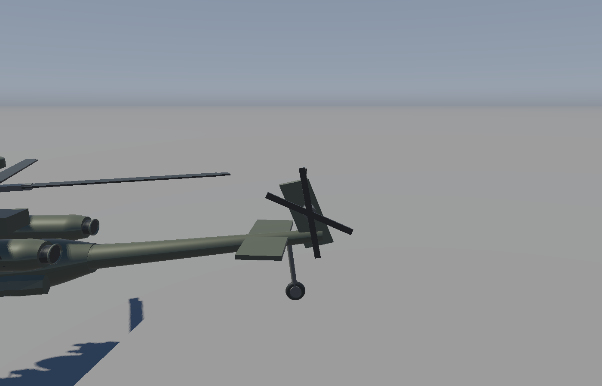
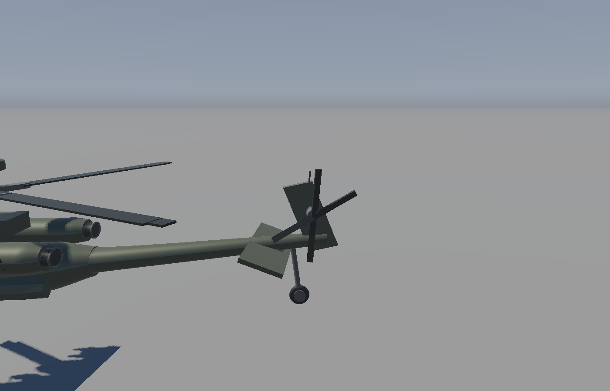

# AH-64D 部件动画与文件职责

动画按“几何 / 对象运动 / 应用调度”组织，不需要新建全局 Animation 文件夹。

| 文件 | 职责 |
| --- | --- |
| `glframework/geometry/AttackHelicopterGeometry.h/.cpp` | 生成机身、主旋翼、尾桨单叶和水平尾翼；声明各转轴位置；创建四份静态网格 |
| `glframework/scene/AttackHelicopterObject.h/.cpp` | 持有网格、转速、相位、变距和尾翼角；按帧推进状态；输出主画面和阴影共用的部件变换 |
| `application/Application.h/.cpp` | 创建对象、传入帧时间、读取按键和处理暂停切换 |
| `src/main.cpp` | 命令行初始相位、变距、尾翼角与限时运行参数 |
| `tests/AttackHelicopterGeometryTest.cpp` | 几何、铰链、帧率一致性、暂停恢复和回中验证 |

## 动作与操作

主旋翼自动绕竖直轴旋转，尾桨自动绕横向轴旋转。四片尾桨保持原来的 55°/125° 剪刀布局。
未激活飞行物理时，`R` 暂停/继续两组旋翼，不重置角度。
进入过 `G` 驾驶后，`R` 改为发动机开关，旋翼转速和升力逐渐变化。
`Space` 在自由模式控制骰子，驾驶时控制爬升。

`Q/E` 改变尾桨叶片绕自身径向轴的角度，最大 ±18°。
`Z/C` 使水平尾翼围绕横向铰链上下偏转，最大 ±20°。
两种控制松键后通过指数响应平滑回中，两键同时按下相互抵消。
旋翼默认速度分别为 480°/s 和 2080°/s，目的是清楚展示转动，不代表实机转速。

按 [开发商 AH-64D 手册](https://www.digitalcombatsimulator.com/upload/iblock/241/a0jh82sp6hjozpfkj537skz629a9sxpz/DCS%20AH-64D%20Flight%20Manual%20EN.pdf)，
方向控制踏板改变尾桨叶片桨距，水平尾翼是可动 stabilator。
固定垂尾保留不动。驾驶时这些输入通过简化飞行模型产生转向或配平力矩，
飞行动力学和第三人称操作见 [飞行说明](AH64D_FLIGHT.md)。
角度上限、速度和回中速率是展示参数，不声称符合实机飞控规律。

## 坐标和变换顺序

`buildParts()` 在 CPU 上把旋翼和尾翼网格转换到各自的转轴坐标系。
所有转轴均在机体坐标中，已包含之前的纵向比例修正。
这样即使移动、缩放或旋转整架飞机，各部件仍围绕自己的轴运动。

```text
机身：    飞机整体 Model
主旋翼：  飞机 Model × 平移到主轴 × 绕 Y 轴旋转
尾桨叶片：飞机 Model × 平移到尾轴 × 绕 Z 轴公转（相位 + 叶片初始角）× 绕局部 X 轴变距
水平尾翼：飞机 Model × 平移到前缘铰链 × 绕尾翼展向轴偏转
```

顶置雷达、垂直尾翼和尾桨安装轴保留在固定机身网格中，不随桨叶公转。
一份尾桨叶片网格复用四次。总共四份 Mesh、七个 DrawItem，顶点只在初始化时上传。
默认每帧绘制三角形数仍是 105,110；尾桨复用后 GPU 顶点数为 315,222。
主 pass 和阴影 pass 调用同一套部件变换，旋翼的可见位置与投影同步。

`update(dt)` 只在帧调度中调用一次，不能分别放进主 pass 和阴影 pass，否则会一帧推进两次。
时间和几何不写入 GLSL，材质与渲染器不需要认识旋翼或尾翼。

## 运行与复现

```powershell
# 交互演示，Q/E、Z/C、R 可操作
./build-verify/Debug/RenderingCube.exe --aircraft-only --no-mouse --camera -3.7 2.2 -5.2 118 -12

# 固定姿态截图：不推进实时时间，便于逐像素复现
./build-verify/Debug/RenderingCube.exe --aircraft-only --camera -3.7 2.2 -5.2 118 -12 --main-rotor-angle 40 --tail-rotor-angle 70 --tail-pitch 18 --stabilator-angle 20 --screenshot pose.bmp

# 隐藏窗口运行真实帧循环一秒，然后截图退出，用于运行期验证
./build-verify/Debug/RenderingCube.exe --hidden --aircraft-only --run-for 1 --screenshot moving.bmp
```

普通截图默认从零相位开始；`--no-spin` 只停止骰子，`--no-rotors` 才停止旋翼。
`--tail-pitch` 和 `--stabilator-angle` 指定初始偏转，进入实时循环后会响应按键并回中。
`--run-for` 使用真实帧时间，结束时的精确相位随帧调度变化；需要确定性画面时请直接指定角度。

## 验证

自动检查覆盖：三种挂载及四份部件的有效几何、30/60 FPS 下的相位和控制响应一致性、
暂停/继续不跳变、松键回中、任意整机变换下的轴心不漂移、水平尾翼铰链轴不漂移、长时间角度有界。
实际 OpenGL 运行确认部件变换生效：暂停运行后的截图与初始姿态逐像素相同，运行后姿态发生改变。

| 中立位置 | 旋翼相位改变、尾桨变距及水平尾翼偏转 |
| --- | --- |
|  |  |
