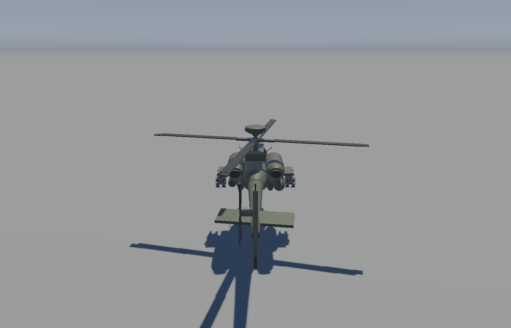

# 飞行动力学与第三人称驾驶

自由相机靠近直升机座舱后按 `G` 进入驾驶，驾驶中可随时按 `G` 退出。
交互使用座舱锚点的三维距离，范围为约 5 个物理米（默认模型下为 1.25 个场景单位）。
远处、尾桨附近或与飞机高度相差较大时无法进入；锚点随飞机移动、旋转和缩放。
窗口标题在范围内提示“按 G 驾驶直升机”，范围外提示靠近座舱并显示距离。
驾驶时鼠标只控制第三人称观察方向，飞机航向由 Q/E 独立控制；WASD 的移动方向以飞机自身为基准。
W/S 沿实际机头水平朝向前进或后退，A/D 沿机身水平左右方向侧移；转动鼠标不会改变按键的运动轴。
摄像头围绕飞机平滑跟随，飞机仍经过加速、倾斜、转向和制动的物理过程。
松开 Q/E 后保持当前目标航向，转动视角不会自动把机头转向镜头方向；再次进入驾驶时从飞机现有朝向开始。

## 文件职责

```text
glframework/physics/
  RigidBodyState.h           米制位置、四元数姿态、线速度、机体角速度
  FlightControls.h           水平目标速度、爬升、朝向、脚蹬和配平输入
  HelicopterParameters.h     质量、惯量、推力、阻力、辅助控制参数和起落架接触点
  HelicopterDynamics.h/.cpp  120 Hz 力/力矩积分、旋翼转速响应、地面接触和渲染插值
glframework/ThirdPersonCamera.h/.cpp
                              轨道观察、摄像头方向映射、跟随与缩放
glframework/scene/AttackHelicopterObject.h/.cpp
                              持有动力学状态，把整机姿态应用到所有部件
application/Application.h/.cpp
                              G 交互、按键输入、每帧调度、驾驶提示与阴影跟随
```

物理目录仅依赖 GLM 和标准库，不依赖窗口、OpenGL 或网格。
部件动画沿用原来的四份 Mesh 和七个 DrawItem；整机运动只改变父级 Model，部件不会散开。

## 操作

| 操作 | 驾驶模式 |
| --- | --- |
| G | 座舱范围内进入 / 驾驶中随时退出，按住不会反复切换 |
| 鼠标 | 自由旋转第三人称观察方向，不改变飞机航向 |
| W / S | 沿飞机实际机头朝向前进 / 后退 |
| A / D | 相对机身左 / 右侧移 |
| Space / 左 Ctrl | 爬升 / 下降 |
| Page Up / Page Down | 另一组爬升 / 下降键 |
| 左 Shift | 提高水平目标速度 |
| Q / E | 独立控制飞机左 / 右转向，同时显示尾桨变距；摄像头观察角度保持独立 |
| Z / C | 水平尾翼偏转，附带轻微俯仰配平 |
| 滚轮 | 缩放跟随距离，限制在 3.5 到 12 个场景单位 |
| R | 发动机开 / 关，转速平滑变化；关闭后飞机会失去升力并落下 |
| Esc | 退出程序 |

驾驶时窗口标题显示控制提示、速度和机体原点的离地高度。
画面右上角还会实时显示速度面板，数值为三维线速度的模长乘以 3.6，单位 km/h、保留一位小数；
自由观察时同样显示这架飞机的速度。
松开 WASD 后辅助控制将目标水平速度设为零，主动减速；松开升降键后将目标垂直速度设为零。
这提供接近游戏第三人称载具的操纵体验，不要求手工连续调节总距来悬停。

退出驾驶不会重置飞机位置或速度。飞机继续在辅助控制下减速悬停，发动机关闭时继续下落。
自由相机从退出时的观察位置继续移动；再次驾驶需要重新靠近座舱。
首次进入驾驶之前仍保留静态展示行为，原有固定姿态截图不会自行坠落。

## 动力学与单位

- 物理按每秒 120 次固定步长更新，渲染位置和姿态在相邻物理状态之间插值。
- 通过重力、沿机体上轴的旋翼推力、线性及二次阻力计算合力，用半隐式 Euler 积分线速度与位置。
- 辅助控制将目标速度转换成有限倾角，姿态误差产生力矩；角速度在机体系积分，姿态使用归一化四元数。
- 推力受归一化旋翼转速平方影响，发动机开关有加减速过程；视觉旋翼速度跟随该状态。
- 三个起落架接触点包含轮胎半径，检测无限平坦地面，修正穿透、垂直速度和水平摩擦。
- 进入驾驶后阴影视锥跟随飞机及其地面投影，避免飞出原来固定的中心阴影区域。

几何一单位约对应两米；默认展示缩放为 0.5，因此每米转换为 0.25 个场景单位。
物理内部仍使用米、秒、千克和 kg·m²；`AttackHelicopterObject` 负责与模型缩放之间的转换。
质量、惯量、控制增益、最大速度和转速响应均为演示调参，未校准到真实 AH-64D。

## 范围

这是带辅助控制的简化六自由度刚体模型。尚未模拟叶素气动、真实发动机/传动、地效、涡环、复杂失速或损伤。
地面接触仅针对平面和起落架；暂不包含飞机与骰子、建筑、机身或旋翼之间的通用碰撞。
物理每帧最多补算 0.25 秒，应用层也限制长帧，避免断点或窗口拖动后出现巨大位移。
镜头俯仰范围为 -85° 到 +85°，可绕到飞机上方或下方，避免完全垂直时的观察方向奇点。
缩放仍有限制，镜头世界高度不低于 0.35 个场景单位；尚未实现复杂障碍物相机避让。

## 运行与验证

```powershell
# 默认启动后按 G；或直接进入驾驶
./build-verify/Debug/RenderingCube.exe --drive --aircraft-only --camera -2.3 1.4 -0.7 0 0

# 隐藏窗口运行两秒，保存第三人称悬停画面
./build-verify/Debug/RenderingCube.exe --drive --hidden --aircraft-only --no-mouse --camera -2.3 1.4 -0.7 0 0 --run-for 2 --screenshot flight.bmp

# 物理和几何检查
ctest --test-dir build-verify -C Debug --output-on-failure
```

自动检查包含重力、长时间悬停、前飞、侧移、制动、爬升、转向、旋翼停机与再起飞、地面接触，
30/60/144 FPS 一致性、四元数归一化、摄像头方向映射、缩放边界和整机与部件变换的同步。
交互检查还覆盖座舱范围边界、垂直距离、尾桨位置和飞机移动后的锚点跟随；
程序运行检查确认默认远处相机被拒绝，靠近座舱的相机可以进入驾驶。
实际窗口检查确认 G 进入驾驶，以及前进与爬升输入带动飞机和摄像头。


