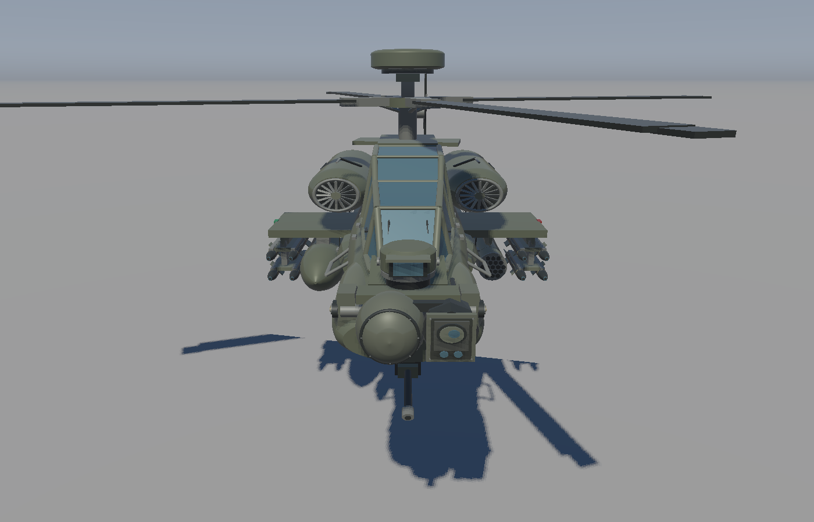
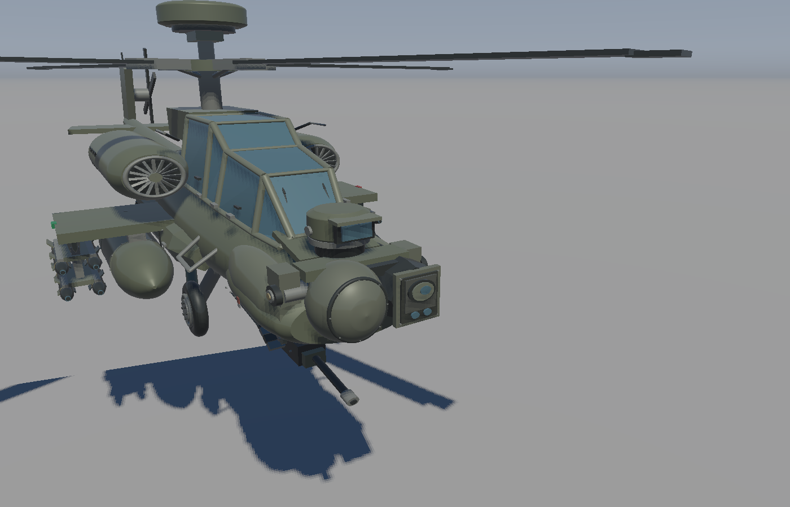

# AH-64D 程序化外形与挂载参考

本次移除了场景中的红色直升机，细化 `AttackHelicopterGeometry`。
实现为可动展示模型，不包含武器功能、飞行仿真或可直接制造的结构数据。

## 参考来源

1. [美国陆军公开航空作业手册，第 9 页 AH-64D Longbow Apache](https://home.army.mil/hawaii/download_file/1a3e6edd-a1fc-4d89-9feb-155d7cdb141f/732)：
   检查侧视轮廓、串列座舱、旋翼轴、发动机、机头传感器、机炮、尾梁和起落架的相对位置。
   本地保存的 [页面预览](ah64d-army-dimensions.png) 可用于核对。
2. [美国陆军 JAMS 资料](https://api.army.mil/e2/c/downloads/2022/03/01/e15e200e/jams.pdf)：
   确认 M261 为十九管火箭发射巢，M299 为四导轨 Hellfire 挂架。
3. [Lockheed Martin HELLFIRE II 产品卡](https://www.lockheedmartin.com/content/dam/lockheed-martin/mfc/pc/hellfire/23-05810-TM_AGMS-HELLFIRE-II-Product-Card-1.pdf)：
   导弹长度 1.63 m、弹体直径 0.178 m；挂架公开外廓为宽 0.599 m、高 0.737 m。
   模型按导弹尺寸生成弹体，挂架和翼片做外形近似。
4. [Boeing 关于 AH-64D 外置油箱的说明](https://boeing.mediaroom.com/1997-10-13-U.S.-Army-Evaluates-New-Fuel-Tank-For-AH-64D-Apache-Longbows-Internal-Unit-Offers-Greater-Range-Increased-Safety-in-Combat)：
   确认 230 加仑油箱安装在外部挂架上。本文不把内部辅助油箱画在机腹外。
5. [DCS 开发商发布的 AH-64D 手册](https://www.digitalcombatsimulator.com/upload/iblock/241/a0jh82sp6hjozpfkj537skz629a9sxpz/DCS%20AH-64D%20Flight%20Manual%20EN.pdf)：
   辅助核对四个短翼挂点与外置油箱关系，属于仿真参考，不作为实机工程图纸。
6. [AH-64 尾桨动力平衡研究，原作者论文](https://www.sciencedirect.com/science/article/pii/S0022460X09003824)：
   尾桨两对叶片采用 55° 方位间隔，模型改为 55°/125° 剪刀布局。
7. [Vertical Flight Society 的 AH-64D 数据页](https://vertipedia.vtol.org/aircraft/getAircraft/aircraftID/32)：
   总体宽度/旋翼直径 14.63 m，机体短翼宽度 5.23 m，用于检查横向比例。

## 坐标与挂点

模型采用 +X 机头、+Y 向上、+Z 右侧；一模型单位对应约 2 m。
展示场景再应用 0.5 倍缩放。下面是**本模型坐标**，原点是建模原点，不是实机 FS/BL/WL 基准。
挂点数量、内外顺序与部件关系按资料布置；未获得带尺寸的 AH-64D 挂架安装图，不能将这些坐标当作实机精确站位。

| 挂点 | 模型 Z | 默认 Mixed | Combat | Ferry |
| --- | ---: | --- | --- | --- |
| 左外 | -1.21 | 四枚 Hellfire | 四枚 Hellfire | 四枚 Hellfire |
| 左内 | -0.80 | 十九管 M261 | 十九管 M261 | ERFS 副油箱 |
| 右内 | +0.80 | ERFS 副油箱 | 十九管 M261 | ERFS 副油箱 |
| 右外 | +1.21 | 四枚 Hellfire | 四枚 Hellfire | 四枚 Hellfire |

四个挂点沿纵向均以模型 X=-0.30 为中心，挂架位于短翼下方。
每个挂点只使用一个载荷，不把油箱与武器叠在同一挂点，也不增加虚构的机腹油箱挂点。
三套方案用于展示不同外形，不宣称是某个具体部队、日期或任务的制式装载。

## 几何细化

- 收窄短翼至约 5.23 m，对照侧视图延长尾梁、缩短机头，并修正机炮和串列座舱位置。
- 降低旧模型过高的机体比例；武器、轮胎和尾桨独立生成，保留圆形截面与武器尺寸。
- M261 端面采用 3/4/5/4/3 的十九孔排布，添加后端管口和加强环。
- Hellfire 采用四枚一组、上下两层，添加导轨、尾翼、控制翼、色带和弹头窗口。
- 右内挂点增加流线形副油箱、环带、吊耳、加油口与管线；挂载避开主起落架。
- 加入旋翼顶端 Longbow 雷达、传动连接杆、左侧剪刀式尾桨、TADS/PNVS 分层机头、机炮摇架与供弹槽。
- 添加侧面航电整流罩、检修分缝、进气/排气口、散热格栅、登机踏步、空速探杆和红绿航行灯。

## 精度范围与验证

公开的总体尺寸可用于建立比例，但当前模型仍是程序化外形近似。
局部蒙皮、传感器、挂点纵向/垂向偏移、副油箱尺寸和导弹翼片均有拟合，
没有完整的厂家工程图纸，不能保证逐部件或毫米级一致。
玻璃使用不透明蓝色材质，没有座舱内部或写实贴图。
旋翼和水平尾翼动画的结构见 [动画实现说明](AH64D_ANIMATION.md)。

默认 Mixed 模型目前为 315,330 个顶点、105,110 个三角形。
三种载荷都经过 CPU 几何验证，包括有限值、索引边界、单位法线、三角形面积与绕序。
另检查圆柱及放样两端封盖的朝外法线、径向平滑法线、环面法线和非均匀缩放时的逆转置法线变换。
实际 OpenGL 渲染已检查左右两侧与默认场景。

## 曲面平滑与追加细节

VBO 个数仍为位置、颜色、法线三个，增加的是缓冲内的顶点数据。
单纯分割更多 VBO 不会改变轮廓或光照的连续性。
机身、发动机和油箱采用环向 64 段、截面间 12 段细分，通过保形三次插值平滑纵向外形。
曲面法线由参数曲面的切向量计算，避免原先每个三角形一条固定法线造成的多边形明暗条带。
端盖保持独立法线，装甲折线、舱窗和翼面保持硬边。
组合机体时使用逆转置矩阵传递法线，垂直比例调整不会把曲面恢复为平面着色。

新增平滑环面轮胎和轮毂、八孔轮毂螺栓、发动机进气风扇与圆形边缘、
副油箱环带紧固件、航电舱盖紧固件、座舱铰链和门把手、圆润雷达罩。
飞机闭合部件在阴影深度 pass 中剔除正面，减少旧模型表面的自阴影条纹。
这些小部件仍属外观拟合，不增加实机精确结构的声明。

## 机头近景修订

依据用户提供的正面近景调整机头外观，仍为照片比例拟合：

- 加宽下颌和两侧整流罩，传感器安装区形成凹台与两侧支承。
- 用右侧圆形 TADS 头与左侧方形日间传感器模块替换原来的两支相同镜筒。
- 增加横向转轴、端部枢轴、支架、密封圈、模块螺钉、大小光学窗口和侧面检修盖。
- PNVS 独立置于上层，补充转动基座、遮光檐和侧面端盖。
- 前风挡改为连续分段玻璃，增加横向边框、雨刷和传感器线束。
- 机炮下移到双侧吊架，补充俯仰枢轴、机匣、枪口与分节供弹链。

默认场景保留骰子。`--aircraft-only` 在建场景时省略骰子，以便相机从正前方接近飞机。
以下机位均可配合 `--screenshot <file.bmp>` 保存确定性截图：

```powershell
# 正面
./build-verify/Debug/RenderingCube.exe --aircraft-only --no-mouse --camera -0.45 1.7 -0.35 -156 -18
# 右前近景
./build-verify/Debug/RenderingCube.exe --aircraft-only --no-mouse --camera -1.05 1.55 0.1 -123 -18
```




